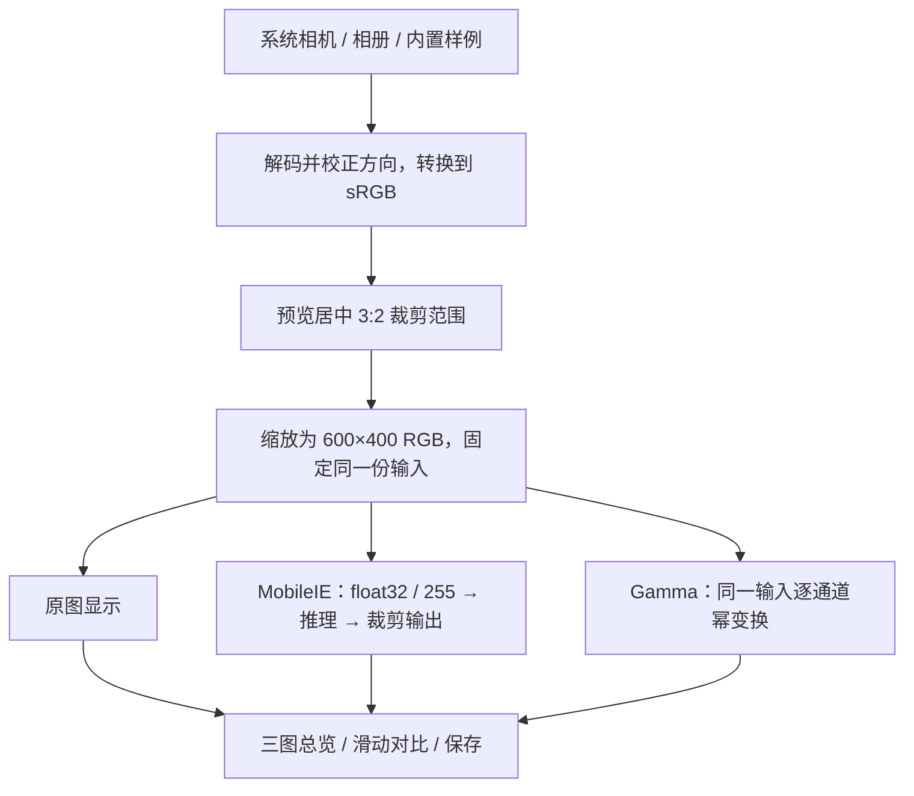

# 05 · MobileIE 微 App 设计草案

- 日期：2026-11-13；作者：Codex  (sqs_A100)。
- 状态：**用户于 2026-11-13 已授权环境完成后自主实现、模拟测试和优化迭代。** 本文为初始设计；实施及结束条件见[07 交付门控](07-delivery-gates.md)。
- 背景：2026-11-16（周一）上午最终验收，导师提前检查；用户主要协助演示。用户要求现场拍照处理，并内嵌一种传统方法作为 baseline，先完成设计。
- 关联：[现有演示方案](01-demo-plan.md)、[验收清单](04-acceptance-checklist.md)、[历史手机实测](../journal/2026-11-12-phone-setup.md)。

## 1. 目标与首版范围

在一加 9R 上完成“现场拍照或相册选图 → 本地处理 → 原图 / MobileIE / 传统方法对比”，让评审能够看到手机实际计算出的增强结果。AI Benchmark 继续承担独立测速展示。

| 功能 | 首版设计 |
| --- | --- |
| 现场拍照 | 调用系统相机拍一张全尺寸照片，返回 App 后确认处理范围，再点击处理 |
| 相册选图 | 通过系统文件选择器选择一张本地照片 |
| 离线样例 | 内置少量已核对来源的暗光输入图，现场可直接处理；不将预先增强图作为实时计算结果 |
| MobileIE | 使用原始官方 TFLite 模型，在本机执行推理 |
| 传统 baseline | 暂定固定 Gamma 校正，指数为 0.5；原理和限制见第 4 节 |
| 图片对比 | 三图总览 + 同位置滑动对比，明确方法标签 |
| 结果保存 | 导出三张处理尺寸图片、三联对比图及本次处理记录 |
| 测速入口 | 提供打开 AI Benchmark 的按钮，自动跳转能力在实现后验证 |

首版覆盖静态单张照片。连续摄像头预览增强、视频处理、训练、模型转换以及更多传统方法不纳入本轮交付。相机调用的是系统拍照功能，不是实时增强取景器。

## 2. 现场操作与页面

主页面保留三个明显入口：“现场拍照”“从相册选择”“使用样例”。获得图片后先显示处理范围，点击“开始对比”后依次计算两种方法，再显示结果。

```text
MobileIE · 低光增强演示
[现场拍照] [从相册选择] [使用样例]

处理输入预览：600 × 400，居中裁剪
[开始对比]

[原图（处理范围）] [MobileIE] [Gamma 0.5]
       三张图片保持相同取景、尺寸和显示比例

大图对比：[原图 ↔ MobileIE] [原图 ↔ Gamma]
              可拖动分界线

MobileIE：CPU · 4 线程 · 本次推理 xx ms
Gamma：指数 0.5 · 本次变换 xx ms
图片准备 xx ms · 两方法处理总耗时 xx ms
[保存对比结果] [打开 AI Benchmark]
```

总览便于投屏讲解；手机上可切换到大图检查暗部细节、色彩、噪声和高光。大图对比必须使用同一坐标与缩放比例。首版不叠加额外的自动亮度或锐化，以免改变方法输出。

拍照、选图取消时保留上一次结果。更换输入后清除旧的方法输出与计时，处理期间禁用重复提交；保存失败不影响查看。执行任务时显示进度，结果到齐前不展示上一张图的结果。App 回到前台、屏幕旋转或系统回收后，按保存的任务标识和图片路径恢复，必要时明确提示重新处理，不假装旧任务仍在运行。

## 3. 同一输入的处理规则



“原图”在对比区域中指模型实际收到的 **600×400 处理输入**，不是未经裁剪的全尺寸照片；界面用“原图（处理范围）”说明。拍摄原文件单独保留，裁剪前先让操作者看到取景范围，防止竖拍时重要内容被裁掉。首版使用固定居中裁剪，不拉伸变形，不加入手动裁剪编辑器。

两种方法必须共享同一个方向校正、色彩转换、裁剪和缩放后的输入。解码时先按尺寸采样，避免将超高像素照片完整展开后再缩小。处理 EXIF 的旋转及镜像方向；HDR/广色域照片在两方法分流前统一到 SDR/sRGB，具体设备解码表现需真机核验。拍照结果继承系统相机本身的曝光、降噪等处理，不称为 RAW 或模型独立恢复的效果。

MobileIE 预处理严格遵循现有官方脚本：RGB 通道，float32 除以 255，NHWC `[1,400,600,3]`；输出裁剪到 `[0,1]` 后乘以 255 并截断为 uint8。预览缩放属于显示步骤，不二次修改保存结果。

## 4. 传统 baseline：固定 Gamma 校正（建议）

建议选 Gamma 校正：它是常见的亮度幂变换，便于解释与复核，逐像素计算即可，不需要额外的 OpenCV 原生库。OpenCV 官方教程给出了 Gamma 校正用于欠曝光图像的示例，见第 10 节。

本 App 明确采用直接指数定义，对 sRGB 编码值的每个 RGB 通道独立计算：

`y = x^0.5`，其中 `x = channel / 255`，输出为 `floor(255 × y)`。

例如归一化输入 0.25 会变成 0.5，暗部因此变亮。使用预先生成的 256 项查找表实现；0 保持 0、255 保持 255。界面始终显示“Gamma（指数 0.5）”，避免与采用 `1/gamma` 记法的工具混淆。

首版固定指数，不逐图调参或提供滑块。它是传统亮度调整对照，不代表最强传统低光算法；它没有空间降噪或细节恢复机制，也可能放大噪声、改变色彩关系。现场应如实展示两者优缺点，不预设 MobileIE 对每张图都更好。不以无 GT 的现场照片计算 PSNR，也不把少量示例当作方法优劣的研究结论。

## 5. 模型、运行方式与计时

| 项目 | 设计约定 |
| --- | --- |
| 模型 | `MobileIE/pretrain/lolv1.tflite`，原样随 APK 打包 |
| 大小与类型 | 23,228 字节，float32 输入输出，23 个标准算子 |
| 目标设备 | 一加 9R，Android 14 / arm64；初拟最低 Android 10，其他设备兼容性另行验证 |
| 运行库 | 独立打包 LiteRT/TFLite，不依赖 Google Play 服务或网络 |
| 首版后端 | CPU，4 线程；复用已初始化的解释器，在后台串行处理 |
| GPU | CPU 版本通过核验后再评估，不能把 AI Benchmark 的成功视为本 App 已验证 |

2026-11-13 已读取模型并核对：原始模型与演示包 `model.tflite` SHA-256 均为：

`2ea09b840634469eceab5263bf7b549c33fcd5df2a25701ce5fefc585402ad44`

首版 CPU 是为了先交付完整的图片处理流程。历史 AI Benchmark 的 CPU 86–91 ms 仅作为参考，不是微 App 的性能承诺；微 App 的 GPU 5.8 ms 也未建立。

以单调时钟记录模型初始化、图片准备、输入打包、模型推理、输出转图、Gamma 变换及本次两方法处理总耗时。MobileIE 的“推理”只统计解释器调用；Gamma 的“变换”统计查表处理，不含显示。总耗时从点击处理到两张结果 Bitmap 就绪，不含拍照、用户选图、保存文件或屏幕实际绘制。导出记录明确各计时范围、是否首次运行/预热，不能用不同范围的数字得出速度排名。

## 6. 与 AI Benchmark 的配合

两个 App 各自执行相同模型，微 App 负责真实照片的输出与对比，AI Benchmark 负责既有标准流程下的延迟展示。打包时记录模型摘要，微 App 的信息区域可查看，以核对同一模型。

“打开 AI Benchmark”只尝试启动已安装的 `org.benchmark.demo`。未安装或不可启动时提示手动打开，仍可使用微 App。进入 Custom Model、选择模型及后端依旧按已有手册操作；公开官方资料中未找到外部 App 提交图片并取回张量或自动读取跑分的接口，不据此设计推理委托链路。

AI Benchmark 的历史实测与微 App 的本次计时分别标注来源；运行库、CPU/GPU 配置及数据传输可能不同，不要求数字一致。演示微 App 时不在后台同时跑压测。

## 7. 拍照、存储与异常处理

拍照使用系统 `ACTION_IMAGE_CAPTURE`，通过受限的 FileProvider URI 和 `EXTRA_OUTPUT` 接收完整图片，不使用 Intent 返回的小缩略图。拍照临时文件保存在本 App 自有目录，取消或失败后清理；待处理 URI 与任务状态需要在相机离开期间保存。采用该路径时不主动申请直接访问摄像头的权限，具体行为按目标系统核验。

相册入口使用系统文档选择器，按 URI 读取单张图片，不申请整个相册访问权限。首版拟不声明联网权限；推理、Gamma 和导出都在本地完成。

| 异常 | 用户可见行为 |
| --- | --- |
| 没有可用相机、拍照取消、相册取消 | 保留此前输入与结果，允许选图或样例 |
| 无法解码、文件过大或格式不支持 | 给出可理解的错误；清理临时资源，允许重新选图 |
| 模型加载或推理失败 | 单独标记 MobileIE 失败，原图和 Gamma 仍可查看；不拿 Gamma 冒充模型输出 |
| 切到 AI Benchmark 再回来 | 保留当前结果；若系统已回收则从本地任务文件恢复或提示重算 |
| 空间不足或导出失败 | 提示未保存成功，保留屏幕结果，不写“保存完成” |

保存操作经用户点击后执行，使用系统媒体存储接口导出 PNG：`input.png`、`mobileie.png`、`gamma-0.5.png` 和带标签的三联图。相关文件用同一任务编号关联，避免覆盖。另提供处理记录导出，包含 App/运行库版本、模型与输入摘要、尺寸、Gamma 定义、后端及分项计时。只导出成功的方法，不生成空白假结果。新生成的图不复制拍摄 GPS 等 EXIF 信息。

## 8. 拟定实现与交付

采用原生 Android 单 Activity，语言与精确依赖版本在实施时按可用工具链锁定。逻辑分为图片获取、共同预处理、MobileIE 运行、Gamma 变换、对比视图和结果导出模块。相机/系统页跳转与界面更新在主线程，图片解码和处理在单独的工作线程；解释器不被多任务并发调用。

拟在 `demo/org/app/` 存放源码、构建配置与复现说明，构建资产和下载缓存位于 zrh 自有项目数据目录。源码按模块小步提交；各阶段推送。合并严禁 fast-forward，必须 `--no-ff`，不 rebase、squash 或强推。

截至本设计，服务器未发现可直接使用的 Java、Gradle 或 Android SDK/adb 入口，也没有现存 Android 工程。这是后续构建工作的待解决依赖，不是已经具备 APK 交付条件。本阶段不安装这些工具。阶段交付预计为源码与锁定依赖、可安装且可核对摘要的 APK、操作说明，以及真机验证截图/录屏和记录；具体 APK 签名与交付位置实施时记录。

## 9. 分阶段与验收条件

| 阶段 | 完成标准 | 当前状态 |
| --- | --- | --- |
| D0 设计 | 用户授权自主实施，并登记验收条件 | 已获授权，见 07 门控 |
| D1 基础链路 | 建立构建环境；样例和相册输入可完成 CPU MobileIE + Gamma 对比 | 未开始 |
| D2 现场能力 | 系统相机全尺寸回传、保存、AI Benchmark 打开入口及异常恢复可用 | 未开始 |
| D3 真机核验 | 一加 9R 离线运行，通过下列检查，保留证据 | 未开始 |
| D4 导师预检查 | 展示真实拍照流程，按反馈修订并完成全流程彩排 | 时间待确认 |

拟定核验项目，均尚未执行：

- 同一张现场照片可得到标记清楚的原图、MobileIE、Gamma，切换时取景一致。
- 使用固定 600×400 PNG 输入，手机 CPU 的浮点模型输出与官方电脑脚本参考比较；先登记容差并检查异常，不能只凭“看起来相似”判通过。GPU 如启用，独立核验数值与实际后端。
- Gamma 查找表与公式逐项一致；黑、白、灰阶、三通道和暗图可正确处理。
- 竖拍、横拍及镜像方向正确；拍照取消、大图、连续切换输入、旋转/重建、离线运行和保存失败均有明确行为。
- Android 14 真机可安装、启动、选图、拍照、导出与重新打开结果；一加 9R 实际冷启动及稳定运行耗时有记录。
- 用于演示的 App 不依赖现场下载，至少准备完整操作录屏和既有对比图作为备用。

最终验收时间已定，导师预检查时间尚未明确。设计确认后先交付静态图片 CPU 完整链路，GPU 属于其后的可选阶段；只有经过真机核验的功能进入现场演示。现有 AI Benchmark + 离线图片方案在新 App 未通过核验前继续作为可用备份。

## 10. 官方资料与待审阅决策

- [Android：相机 Intent 与 EXTRA_OUTPUT](https://developer.android.com/guide/components/intents-common#Camera)：系统相机拍摄、完整图片输出及缩略图区别。
- [Android：MediaStore 相机动作](https://developer.android.com/reference/android/provider/MediaStore#ACTION_IMAGE_CAPTURE)：输出 URI、ClipData 及权限相关行为。
- [LiteRT：Android GPU 与独立运行库](https://ai.google.dev/edge/litert/android/gpu)：无 Google Play 设备可使用独立库；GPU 初始化与调用线程约束需遵守。
- [AI Benchmark：自定义 TFLite 模型](https://ai-benchmark.com/news/2020_05_31_may_release.html)：加载模型、选择后端和获取延迟/错误日志的官方流程。
- [Android：应用间启动](https://developer.android.com/training/package-visibility/use-cases)：启动外部 Activity 与处理不可用的情况。
- [OpenCV：Gamma 校正教程](https://docs.opencv.org/4.x/d3/dc1/tutorial_basic_linear_transform.html)：幂变换亮度调整的参考，App 计划自行实现该公式，不引入 OpenCV 依赖。

初始设计的主要取舍为：**系统拍照后单张处理、固定 Gamma 指数 0.5 作为传统对照、预览居中裁剪到 600×400、CPU 完整链路优先。** 用户现已授权自主决策实施，但实际交付必须以 07 门控和最终证据为准。
