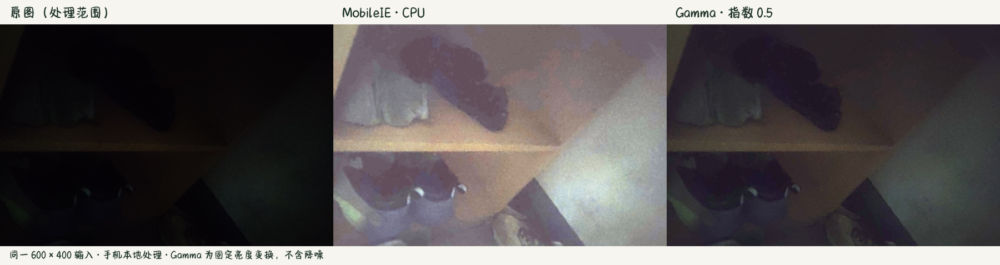

# 10 · 微光实验室 0.1.1 真机检查（一加 9R）

- 执行：2026-11-13 09:21–09:33 · claude code (local)，Windows 11 + adb 37.0.1（USB）
- 对象：**微光实验室 MobileIE LightLab 0.1.1**（`dev.zrh.mobileie`）
- 关联：[08 交付说明 §6 真机接续](08-app-delivery.md)、[09 最终报告](09-app-v011-final.md)、[操作说明](../demo-package/微光实验室操作说明.txt)、证据 [`results/phone-0.1.1/`](../results/phone-0.1.1)
- 结论：**安装、启动、样例/拍照/相册、对比、保存与 AI Benchmark 跳转均在本机跑通**；发现 1 个可复现性待定的选择样例失效问题（见 §5）。Windows 桌面版与导师预检查仍未做。

## 1. 设备与环境

| 项 | 值 |
| --- | --- |
| 机型 | OnePlus 9R（LE2100），序列号 `b62e7c1` |
| 系统 | Android 14（SDK 34），`OnePlus/OnePlus9R_CH/OnePlus9R:14/UKQ1.230924.001/R.1cf3047-1-5f78e` |
| ABI | arm64-v8a |
| 连接 | `F:\dev-tools\android-sdk\platform-tools\adb.exe` 1.0.41 / 37.0.1，USB 调试已授权 |

## 2. 安装包校验

- 来源：服务器 `/data/Users/zrh/data/MobileIE-Neo/demo/org/releases/0.1.1/MobileIE-LightLab-0.1.1.apk`，scp 到本机；
- 大小 18,115,838 字节，SHA256 `3451182678596d3672d3a7e81c5b12cd6ca609cb50695665e7b44e51234447a8`，与 [`release.json`](../results/app-0.1.1/release.json) 一致；
- `adb install -r` 返回 `Success`；`dumpsys package` 显示 `versionName=0.1.1`、`versionCode=2`、`primaryCpuAbi=arm64-v8a`，首次安装时间 2026-11-13 09:22:42。

## 3. 功能与耗时

| 步骤 | 结果 | 证据 |
| --- | --- | --- |
| 冷启动（安装后首次） | `am start -W` 总耗时 **472 ms**（LaunchState: COLD） | — |
| 冷启动（force-stop 后） | **411 ms** | — |
| 热启动（进程已在后台） | **95 ms** | — |
| 内置样例 1 → 开始对比 | 完成；界面显示 **MobileIE 107.1 ms · Gamma 3.7 ms** | [`02-sample-result.png`](../results/phone-0.1.1/02-sample-result.png) |
| 现场拍照（真实暗光场景）→ 处理 | 完成；**MobileIE 106.7 ms · Gamma 3.7 ms** | [`04-camera-result.png`](../results/phone-0.1.1/04-camera-result.png) |
| 相册选图 | 调起系统文档选择器；返回后成功处理，状态显示「相册照片 · 600 × 400」（该次未保存记录） | — |
| 取消拍照 | 提示「已取消拍照，保留此前结果」，旧结果未丢失 | — |
| 三图总览 | 正常，三栏同取景并带标签 | [`03-overview.png`](../results/phone-0.1.1/03-overview.png) |
| MobileIE / Gamma 切换 | 正常 | — |
| 拖动分界线 | 正常，分界位置随拖动改变 | [`06`](../results/phone-0.1.1/06-divider-before.png) / [`07`](../results/phone-0.1.1/07-divider-after.png) |
| 保存对比结果 | 提示已存相册与记录目录；文件均落盘（见 §4） | [`05-saved.png`](../results/phone-0.1.1/05-saved.png) |
| AI Benchmark 跳转 | 打开 `org.benchmark.demo/.RunClassifyModel`（已有历史测试页） | [`08-ai-benchmark.png`](../results/phone-0.1.1/08-ai-benchmark.png) |

### 3.1 本次计算记录（现场拍摄）

[`record-camera.json`](../results/phone-0.1.1/record-camera.json)：

| 字段 | 值 |
| --- | --- |
| source_label | `现场拍摄` |
| 尺寸 / 裁剪 | 600 × 400，EXIF 校正后居中 3:2 裁剪，RGB/sRGB |
| preparation_ms | 133.78 |
| packing_ms | 39.05 |
| **inference_ms** | **106.66** |
| rendering_ms | 51.08 |
| processing_total_ms | 200.56 |
| gamma_ms | 3.69 |
| runtime | LiteRT 1.4.2 CPU built-in, 4 threads |
| model_sha256 | `2ea09b84…02ad44`（与 release.json 一致） |
| app_version / run | 0.1.1 / 1 |

说明：这里的 106.7 ms 是本 App 自身计时（含 CPU 内置算子推理），与 11 月 12 日 AI Benchmark 的历史数字（GPU FP16 5.76/5.95 ms、CPU 86–91 ms）不是同一套测量，不能混用。

## 4. 导出文件

保存后在设备上确认：

- `/sdcard/Pictures/MobileIE/`：`*_comparison.png`、`*_input.png`、`*_mobileie.png`、`*_gamma-0.5.png` 共 4 张；
- `/sdcard/Download/MobileIE/`：`*_record.json`（即 §3.1）。

导出对比图（原图 / MobileIE / Gamma 三栏）：

## 5. 发现的问题

1. **内置样例选择偶发不生效（待修复/定位）**：09:29:50–09:31:20 之间连续 3 次点「内置样例 → 01 · 书柜」后，状态栏仍停留在「选一张暗光照片」，`开始对比` 保持禁用，无错误提示；`am force-stop` 后冷启动即恢复正常。
   - 触发前该 App 经历过：相机往返、AI Benchmark 跳转返回、系统截图编辑器（`com.oplus.screenshot`）意外覆盖前台、后台滚动等；
   - 之后单独验证「Home → 恢复 → 选样例」**正常**，说明不是单纯 resume 引起，未定位到最小复现条件；
   - 现场风险：演示中若出现，先用返回键重进 App，仍无效则强制停止再开。**11-16 验收前应定位并修复**。
2. **AI Benchmark 返回**：在其测试页/结果页按返回键会先回到 AI Benchmark 自己的上一页，不能一键回本 App；现场用最近任务或桌面切换回微光实验室即可（本次即如此返回，结果与三图总览状态保留）。
3. 本机自动化误触多次（滚动/截图手势），不影响上述结论；所有结论均有截图或系统记录对应。

## 6. 仍未完成

- [ ] Windows 本机运行 Python 桌面版（Tk/DLL/DPI/文件对话框）；
- [ ] 导师预检查（形式、时间、地点），并留存反馈与真机录屏；
- [ ] §5.1 样例失效问题的定位与修复。

## 7. 修订记录

- 2026-11-13 · claude code (local)：一加 9R 安装 0.1.1 并完成样例/拍照/相册/对比/保存/AI Benchmark 跳转检查，记录耗时与 1 个待修复问题。
