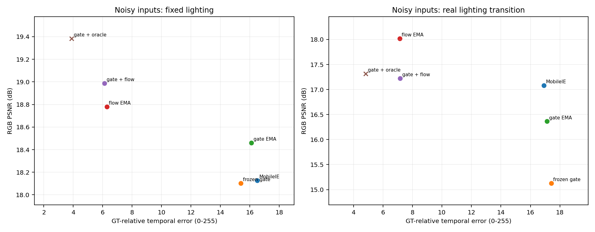

# 首轮自主调研与预实验：分离映射变化、噪声与运动误差

- 创建：2026-11-10 18:29 +08:00 · Codex  (sqs_A100)
- 触发：用户授权自主开展前期探索、决策和小步密集提交，要求完整记录过程；当前没有确定的最终方法。
- 状态：本轮预实验与审计已完成；未进行正式训练，未确定论文方法。
- 关联：[调研地图](../../research/5.prior-art-survey/docs/08-exploration-literature-map.md)、[执行前协议](../../research/4.temporal-consistency/docs/exploration-r1-protocol.md)、[完整过程记录](../../research/4.temporal-consistency/process/exploration-r1/journal.md)、[生成表格](../../research/4.temporal-consistency/report/exploration-r1/tables.md)。

## 1. 本轮完成什么

1. 核查10项相关工作的机制与重复风险，补读FastLLVE和CRISP的方法/训练章节，其余明确标记阅读层级与未完成项。
2. 建立不覆盖旧结果的新评价代码，修正平移有效区域和反向光流采样，使用float差分和无损展示缓存。
3. 完成13种单项/组合控制的351条评估；根据结果追加两组各270条的状态组合评估。
4. 完成18种固定场景噪声条件的特征探针，每种16次采样，观察FST/HDPA响应。
5. 保存逐序列CSV/JSON、配置、哈希、环境、stdout、失败检查、PNG/SVG图；代码、资料与报告分别提交。

合计891条方法—序列评估，但仅有54种不同输入条件；其中固定光照输入在两组矩阵中重复使用。不能将891条当作独立样本或正式测试集规模。

## 2. 条件与口径

- 3张仓库已有图：source_scene与两张LOL示例GT；没有新增独立真实视频。
- 每段32帧、320×240、平移0/4/12像素/帧；噪声条件使用2个固定种子。
- 噪声为泊松40光子+读出噪声0.008+JPEG70；所有方法共享同一输入。
- 权重为官方LOLv1 slim；本轮完全没有学习/更新权重。
- 主要残差为去除四边8像素后的有效平移重叠区域平均差，单位0–255。
- PSNR按整幅RGB MSE计算；SSIM采用11×11高斯窗的有效区域。数值不能与旧脚本、其他分辨率或LOLv1官方测试结果混比。
- 新代码采用float输出进行评价；PNG只作为展示，旧结果保持原状。
- 新评价底座7项检查通过，增加状态分批及光照变化检查后9项通过。

## 3. 控制实验结果

下表为固定目标光照、噪声+压缩下18条序列的平均值：

| 方法 | PSNR↑ | SSIM↑ | 内部对齐残差↓ | 用途 |
| --- | ---: | ---: | ---: | --- |
| MobileIE逐帧 | 18.127 | 0.424 | 16.473 | 起点 |
| 冻结首帧全局注意力 | 18.102 | 0.438 | 15.373 | 机制干预 |
| 输入双边滤波后增强 | 16.533 | 0.516 | 13.162 | 单帧传统控制 |
| 输出高斯平滑 | 18.707 | 0.581 | 11.248 | 空间模糊控制 |
| 输出EMA，0.9 | 17.715 | 0.540 | 5.428 | 时域平滑控制 |
| Farneback运动补偿EMA，0.9 | 18.393 | 0.609 | 4.288 | 可部署后处理基线 |
| 真值平移补偿EMA，0.9 | 19.215 | 0.658 | 1.457 | 对齐分析参照，不能作部署方法排名 |

### 3.1 固定输入去噪不是可靠组合

输入双边滤波虽然降低帧差，但PSNR相对原模型平均下降1.594dB，18条噪声序列中16条下降。再叠加运动补偿并未消除画质问题。

这只说明当前固定滤波参数与未适配的预训练模型组合有明显风险。不能据此否定其他传统去噪、可学习去噪或联合训练；需要区分输入分布改变、细节损失和增强映射响应。

### 3.2 运动估计是有价值的切入点

真值补偿比低光Farneback更稳定。已知位移为4/12像素时，估计光流平均EPE分别约2.89/8.81像素。

这说明本轮低光Farneback的对应关系不够准确，值得进一步比较去噪/增强特征上的对齐、可靠性处理及其他运动估计。它不代表所有光流方法的上限，也不代表当前纯平移结果能推广到遮挡和视差。

### 3.3 clean与噪声条件的机制不同

在无噪声、仅低光的平移中，冻结全局注意力后，内部残差在本轮记录中为0；原逐帧模型平均约0.991。固定局部卷积在有效内部区域应满足平移等变，这一现象符合预期。

加入噪声与压缩后，冻结注意力仅把残差从16.473降到15.373，PSNR没有稳定提升。这比此前“全局注意力不是主因”的概括更具体：构图导致的映射变化与随机噪声条件需分别研究，不能凭单项干预排除整个分支。

## 4. 根据结果追加组合预实验

在原全局门控上使用0.9的EMA，状态只有12个float；再与输出运动补偿EMA（0.7）组合。这是标准状态控制基线，不作为创新声明。两组均包含原模型、单项、组合及真值补偿参照。

| 噪声条件 | 原模型PSNR | 仅门控EMA | 仅光流EMA | 门控+光流EMA |
| --- | ---: | ---: | ---: | ---: |
| 固定目标光照 | 18.127 | 18.460 | 18.781 | **18.987** |
| 目标光照0.6→1.0突变（合成） | 17.083 | 16.363 | **18.021** | 17.226 |

固定光照时，组合比单用光流EMA平均多0.206dB，内部残差由6.117降到5.966；相对原模型，组合在18条序列中16条提升PSNR，但仍有负例。

光照变化时，同一组合比单用光流EMA平均少0.795dB。固定首帧门控更差，18条噪声序列中全部降低PSNR，平均下降1.957dB。

因此，组合有局部互补性，也有明确适用边界；固定EMA不能直接当最终视频适配方案。下一步可研究历史可靠性、场景/光照变化检测、可学习状态更新与重置。具体是否由响应滞后造成，仍需帧级轨迹诊断，当前序列均值不构成完整因果证明。

相对GT的时间变化误差也已保存。因为GT光照真实变化时，其自身帧差不应被压到0，不能只按输出差值越低越好排名。

## 5. FST/注意力探针与结构假设

固定场景、多次独立噪声下，记录FST前后、全局/局部注意力及输出层相对clean特征的变化。平方变换的线性项与二阶项在不同噪声条件下差别明显，部分强噪声条件中二阶项的能量更大，值得研究稳健的特征变换和噪声控制。

但各层特征尺度、后续注意力及输出裁剪不同，不能把中间特征RMS或二阶项能量直接解释为最终闪烁贡献。后续需要匹配画质、匹配预算的训练干预。

初版最大绝对恒等式误差0.03125，发生在大幅值特征；增加尺度相对误差后最大约2.26e-7。保留两个版本，是数值核查的改进，不是两组独立重复实验。

## 6. 调研对候选路线的约束

StableLLVE已覆盖单图合成序列与时序一致性；FastLLVE把视频映射与去噪组合；RetinexMCNet、DWTA、TempRetinex等覆盖分解、记忆和多种训练/推理机制；CRISP讨论循环训练的课程安排。阅读深度及一手链接见[调研地图](../../research/5.prior-art-survey/docs/08-exploration-literature-map.md)。

本轮调研没有证明某个方向空白，也没有确认最终创新点。它为组合设计提供机制参照，并要求后续把相似之处与差异落实到操作、预算和实验中。

## 7. 下一轮探索安排

保持至少三条可组合候选：

1. **低维映射状态**：比较固定EMA、变化检测重置、学习型/置信度更新，检查跨场景与光照响应，补帧级轨迹。
2. **噪声与特征变换联合适配**：比较普通去噪增广、传统强去噪控制和稳健FST候选；避免直接替换激活后用受损预训练网络作结论。
3. **低成本时间冗余与可靠性**：比较输入/输出对齐、轻量特征状态、时空shift/帧拼接及其组合，加入遮挡与局部运动。

推进前继续修复训练实验的控制变量与断点恢复，核查IWO阶段和损失；获取独立真实视频后再进行更强的泛化筛选。当前小样本只用于安排优先级，暂不展开完整多变体长程训练。

## 8. 复核与资源

- [逐序列控制矩阵](../../research/4.temporal-consistency/results/exploration-r1-v1/per_sequence.csv)
- [固定光照组合](../../research/4.temporal-consistency/results/exploration-r1b-state/per_sequence.csv)
- [目标光照变化组合](../../research/4.temporal-consistency/results/exploration-r1b-light-step/per_sequence.csv)
- [特征诊断](../../research/4.temporal-consistency/results/exploration-r1-feature-noise-v2/layer_response.csv)
- [结果审计](../../research/4.temporal-consistency/report/exploration-r1/audit.json)
- [命令与环境及失败记录](../../research/4.temporal-consistency/process/exploration-r1/journal.md)

同组GPU0/1，最多同时2张；矩阵与探针的计时循环区间累计约537.568 GPU秒，不含初始化。GPU0约364.065秒、GPU1约173.503秒；两组合任务并行。全部结束，未留下占卡任务。

## 9. 修订记录

- 2026-11-10 18:29 +08:00 · Codex  (sqs_A100)：记录首轮自主调研、两阶段预实验、机制诊断、正负结果、局限与下一轮假设。
