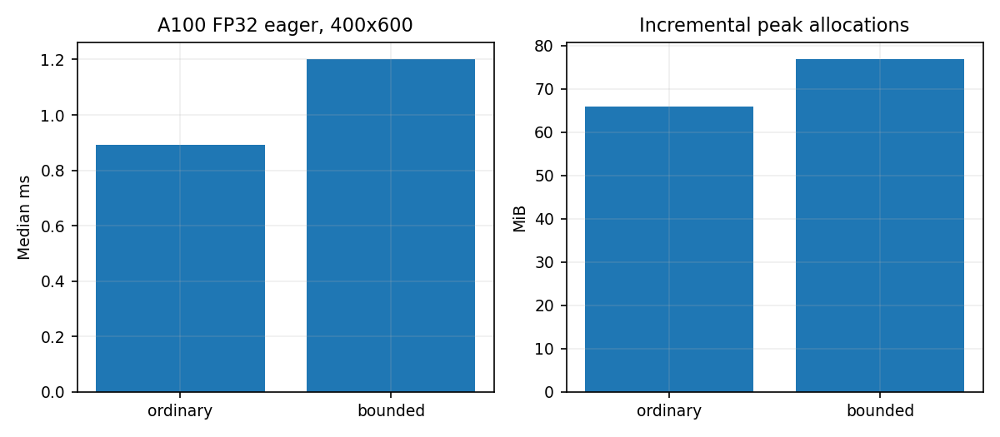
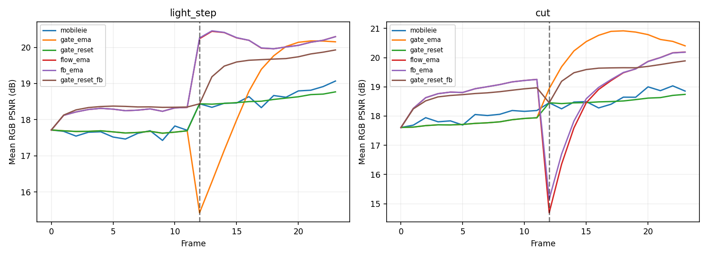
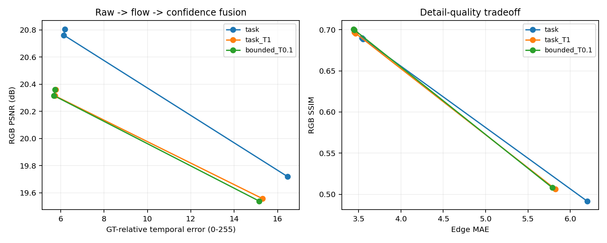

# 第二轮：受控训练、独立场景与更强组合基线

- 创建：2026-11-10 21:13 +08:00 · Codex  (sqs_A100)
- 触发：用户要求深度与广度并行、自主执行，使用共享GPU前确认性能余量。
- 阶段：前期探索；本轮完成，不代表正式实验或最终方法已确定。
- 关联：[0011阶段判断](0011-T-26111019-广度转深度评估.md)、[执行前协议](../../research/4.temporal-consistency/docs/exploration-r2-protocol.md)、[完整过程](../../research/4.temporal-consistency/process/exploration-r2/journal.md)。

## 1. 完成范围与证据边界

- 12次受控训练，每次400次更新，合计4800次；包含6种配置、2个训练seed。
- 训练/标定用6张图，探索验证用另外6张；验证包含平移、目标光照突变、运动前景/遮挡和场景切换，输入噪声seed=0/1，共48种输入条件。
- 训练验证576条、状态控制384条；追加融合864条中288条是重复raw审计，576条为新增融合控制。扣除重复，共1536条方法—序列评估，不能当作1536个独立视频。
- 状态实验另保存9216条逐帧轨迹；数学微验证45个标量条件不计入模型评估规模。
- 16项测试通过；每个训练run均400步、checkpoint哈希一致、同seed初始任务损失差为0，重复raw推理差为0。

来源为Kodak图像01–12；原站部分401后使用已核查的FFDNet作者仓库镜像，其中9张为500×500版本。统一等比cover并中心裁剪后合成视频。原图、版本、URL、SHA256及镜像Git blob核查均保留；本轮不声称标准Kodak评测、真实视频泛化或与原预训练数据无重叠。

## 2. 深度：用训练控制检查结构假设

从相同官方slim权重进行短程探索微调：统一双帧Charbonnier、相同crop/噪声数据流、Adam、同更新数。没有将这一微调冒充原论文的2000轮、warm-up和IWO完整复现。

有界FST把原平方与tanh有界路径混合，两个混合系数初始0，确保起始函数相同；阈值只由训练图像标定。它是已知有界激活思想的候选，不是新颖性声明。额外gamma学习率和全参数梯度裁剪的交互仍是优化差异，尚不能声称完全隔离结构因果。

下表为6个探索验证场景、4类条件、2个输入种子，并平均2个训练seed的结果。时间误差为有效对应区域中相对GT时间变化的误差，单位0–255：

| 配置 | PSNR↑ | SSIM↑ | GT相对时间误差↓ |
| --- | ---: | ---: | ---: |
| 预训练模型 | 18.277 | 0.4718 | 17.316 |
| 普通任务微调 | 19.719 | 0.4916 | 16.465 |
| 任务+时序0.1 | 19.715 | 0.4938 | 16.293 |
| 任务+时序0.5 | 19.661 | 0.5007 | 15.753 |
| 任务+时序1.0 | 19.557 | 0.5062 | 15.307 |
| 有界FST+任务 | 19.578 | 0.5053 | 15.365 |
| 有界FST+任务+时序0.1 | 19.539 | 0.5080 | 15.156 |

普通任务微调已经解释约1.44dB的平均提升。提高时序权重能在原结构上取得与当前有界结构接近的权衡，因此不能把小幅时间误差改善直接归为新结构独有收益。只有两个训练seed，表中相近差异也未建立统计显著性。

完整逐seed与逐条件表见[训练证据](../../research/4.temporal-consistency/report/exploration-r2/tables.md)。

## 3. 结构成本改变优先级

同一A100，FP32 PyTorch eager，1×3×400×600，交替顺序3块，每块50次warm-up、200次计时：

| 结构 | 参数 | 中位前向时间 | 增量峰值分配 |
| --- | ---: | ---: | ---: |
| 原结构 | 4075 | 0.891ms | 65.92MiB |
| 有界FST | 4077 | 1.202ms | 76.93MiB |

参数仅多2个，当前实现延迟却增加约35%。这些是A100 eager诊断，不是手机延迟，也不证明所有有界变换实现都慢；但足以降低当前tanh候选的优先级。它没有显示足以抵偿当前额外开销的优势。

## 4. 广度：门控、重置与对齐不能只看理想平移

新场景上，固定门控EMA和简单重置没有普遍改善画质：

| 情形 | 逐帧PSNR | 固定门控EMA | 重置门控 | 普通flow EMA | 重置门控+置信度融合 |
| --- | ---: | ---: | ---: | ---: | ---: |
| 平移 | 18.311 | 18.029 | 18.029 | 19.283 | 18.964 |
| 目标光照突变 | 18.127 | 18.229 | 18.116 | 19.201 | 18.917 |
| 局部运动/遮挡 | 18.397 | 18.119 | 18.119 | 19.113 | 18.868 |
| 场景切换 | 18.277 | 19.095 | 18.150 | 18.754 | 19.089 |

检测器在本轮合成光照/切换中每段触发一次，在平移/遮挡中未触发，但“检测对事件”并不等于“清空门控状态能优化输出”。逐帧曲线还显示，普通flow融合在切换瞬间可有明显画质谷值；组合在瞬间和长期的得失也不同。后续应分离门控重置与输出历史重置，而不是用平均值概括一种通用策略。

前后向一致性置信度在部分条件改善画质，但时间误差未必同时最低；拒绝历史、接受当前噪声会改变权衡。NLM输入控制也没有消除这一矛盾。首轮3张图上的经验没有直接推广为新场景规律，这正是补充广度的价值。

## 5. 补齐训练+后处理强对照

从已经训练的模型出发，使用相同flow和前后向一致性融合（alpha=0.7）。重新计算的288条raw结果与先前完全一致。

| 模型 | 融合 | PSNR↑ | SSIM↑ | GT相对时间误差↓ |
| --- | --- | ---: | ---: | ---: |
| 普通任务微调 | 无 | 19.719 | 0.4916 | 16.465 |
| 普通任务微调 | flow | 20.762 | 0.6902 | 6.147 |
| 普通任务微调 | 前后向置信度 | 20.806 | 0.6887 | 6.194 |
| 普通结构+时序1.0 | 前后向置信度 | 20.359 | 0.6957 | 5.785 |
| 有界结构+时序0.1 | 前后向置信度 | 20.360 | 0.6995 | 5.736 |

后两组PSNR几乎相同，有界版本时间误差仅进一步改善约0.8%，而其当前结构前向增加35%。因此，本轮没有足够依据优先推进这一个有界实现。普通任务训练+融合与强时序训练+融合各有权衡，应作为下一轮必须面对的强基线。

前后向光流和置信度的单线程CPU诊断累计约30.24秒/1104对，平均约27.4ms/对，提示显式对齐可能是系统成本重点。这不是标准端到端测速；不能与不同分辨率的GPU前向相加推导手机FPS。

## 6. 调研与数学动机保留新的结构入口

当前tanh候选降级不等于放弃改造原骨干。进一步核查NAFNet官方乘法门控、TSM在线时间移动、已有时序双线性研究和Noise2Noise相关统计动机，记录在[定向调研09](../../research/5.prior-art-survey/docs/09-feature-products-and-temporal-correlation.md)。

在等真值、零均值同方差噪声的简化条件下，两个观测乘积的偏差为rho·sigma²；自平方对应rho=1，独立观测rho=0。45个CPU标量条件验证了闭式偏差/MSE，但这没有证明神经特征噪声独立，也没有处理运动、光照和JPEG相关性。

下一轮可先测中间特征的均值/协方差，再决定是否把FST内部自交互改为受可靠性控制的跨帧交互。乘法、双线性、时间shift本身已有先例，不能重新命名为贡献；需要机制、预算、训练和真实数据证据。

## 7. 自主决策与下一轮安排

1. 降低当前tanh有界FST的实现优先级；保留噪声传播问题，不把一次算子实现的失利当作整个结构方向无效。
2. 不把门控EMA/简单重置当最终路线。优先分离输出历史、门控状态和可靠性判断，解释切换瞬间的误差。
3. 保留“普通训练+时间融合”及不同lambda的Pareto前沿，后续方法须超过强对照，避免只比原始逐帧权重。
4. 深挖真实特征噪声相关性与有效时间信息注入；在理想对应下也无收益的候选应及时停止，再谈低成本可部署对应关系。
5. 广度补独立真实视频、相关噪声、自动曝光及更强传统/学习型对照；尚未使用的图像13–24继续保留，已看过的07–12不当最终盲测集。
6. 正式实验前仍需复核完整MobileIE训练/IWO、数据划分、预算和端到端效率；本轮400步微调不替代这些工作。

## 8. 共享GPU与过程留存

所有GPU任务均经过两次显存≤64MiB、利用率≤5%、无计算进程检查。同组4–7最多同时4个任务；4号卡后来出现他人40GB任务时，启动器拒绝运行，改在重新确认空闲的6号卡上执行。未抢占或结束他人任务。

计入失败计算的累计子进程卡时约1204.240 GPU秒；拒绝启动不计计算时间。包含CPU准备/指标等待，不是CUDA核活跃时间。所有本轮研究GPU进程已结束。

- [资源审计](../../research/4.temporal-consistency/process/exploration-r2/resource-accounting.json)
- [流程、异常与复现命令](../../research/4.temporal-consistency/process/exploration-r2/journal.md)
- [训练/状态审计](../../research/4.temporal-consistency/report/exploration-r2/audit.json)
- [融合审计](../../research/4.temporal-consistency/report/exploration-r2-fusion/audit.json)

代码、数据、图表、过程资料和本报告分别小步提交；权重/优化器缓存有路径和SHA256，按项目忽略规则保留在本地缓存。本轮未触发恢复训练验证；未隐藏下载失败、序列化失败、资源拒绝和版本记录的局限。

## 修订记录

- 2026-11-10 21:13 +08:00 · Codex  (sqs_A100)：记录受控训练、补强对照、独立场景反例、结构成本、自主优先级调整及下一轮假设。
