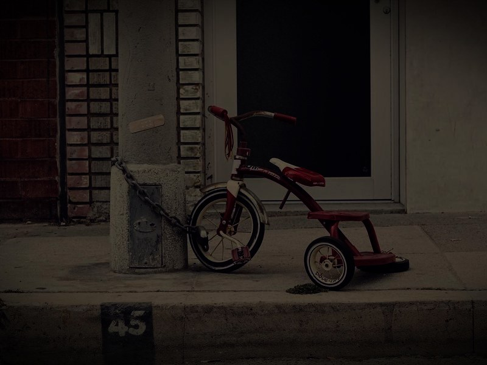
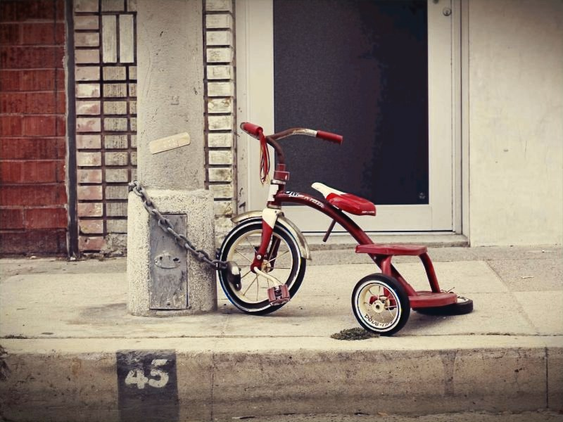

# 2. 复现（Reproduction）

目标：在本机跑通 MobileIE 官方代码，验证预训练权重、推理流程与速度指标，为后续「视频闪烁」课题提供可信基线。

- 上游仓库：`github.com/AVC2-UESTC/MobileIE`，vendored 于 [`MobileIE/`](MobileIE)，对应提交 `7030d12`（2025-08-05，`Add files via upload`）
- 状态：**已跑通**（预训练权重加载 → demo 推理 → 输出图像 / 速度测量）
- 复现报告（HTML，资源内嵌）：[`report/reproduction-report.html`](report/reproduction-report.html)

## 1. 环境

| 项 | 值 |
| --- | --- |
| 系统 | Windows 11 家庭中文版 10.0.26200 |
| GPU | NVIDIA GeForce RTX 5060 Laptop GPU（8 GB，驱动 573.22） |
| Python | 3.13.5（`D:\python`，无 conda） |
| 虚拟环境 | `F:\dev-tools\python-envs\MobileIE-Neo`（统一环境站，不入库） |
| PyTorch | **2.7.1+cu128**（torchvision 0.22.1+cu128） |
| 其他 | opencv-python 5.0.0、numpy 2.5.4、PyYAML、tqdm、thop、scipy |

安装命令（阿里云镜像，pip 临时/缓存目录指向 F 盘，避免占满 C 盘）：

```bash
export TEMP=F:/pip-tmp TMP=F:/pip-tmp TMPDIR=F:/pip-tmp
PY=F:/dev-tools/python-envs/MobileIE-Neo/Scripts/python.exe
"$PY" -m pip install torch==2.7.1+cu128 torchvision==0.22.1+cu128 \
  --find-links https://mirrors.aliyun.com/pytorch-wheels/cu128/ --cache-dir F:/pip-cache
"$PY" -m pip install opencv-python pyyaml tqdm thop scipy --cache-dir F:/pip-cache
```

> **torch 版本注意**：本机安装 `torch 2.9.1+cu128` 时 `c10.dll` 初始化失败（`WinError 1114`），2.7.1 正常。RTX 5060 为 Blackwell 架构（sm_120），必须用 cu128 及以上的 CUDA 版本轮子。

## 2. 运行

```bash
cd MobileIE
mkdir -p experiments                     # 上游 assume 该目录已存在
"$PY" main.py -task demo  -model_task lle -device cuda
"$PY" main.py -task test  -model_task lle -device cuda   # 需测试集与 GT
"$PY" main.py -task train -model_task lle -device cuda   # 需 LOL 数据集
```

配置见 `MobileIE/config/lle.yaml`（已改为本地可跑：`type: re-parameterized`、`need_slim: true`、`pretrained: ./pretrain/lolv1_best_slim.pkl`、`demo_inp: ./data/samples/lowlight`）。

## 3. 本地对上游代码的修改（均已标注 `local change`）

| 文件 | 改动 | 原因 |
| --- | --- | --- |
| `main.py` | `CUDA_VISIBLE_DEVICES` 由硬编码 `'5'` 改为 `setdefault('0')` | 单卡机器上 '5' 不可见 |
| `main.py` | 新增 `imwrite_unicode()`，替换两处 `cv2.imwrite` | **中文路径下 `cv2.imwrite` 静默返回 False**，输出为空 |
| `config/lle.yaml` | demo/pretrained/type/need_slim 指向本地权重与样例 | 无 LOL 数据集时的演示配置 |

另外：`config/*.yaml` 需保持 **UTF-8 且不含中文注释**（上游用默认编码 `open()` 读取，本机 locale 为 GBK 会解码失败）。

## 4. 复现结果

**权重加载**（`weights=12`）：

| 权重 | 模型类 | 参数量 | 加载 |
| --- | --- | --- | --- |
| `lolv1_best_slim.pkl` | `MobileIELLENetS` | 4,075 | 0 missing / 0 unexpected |
| `uieb_best_slim.pkl` | `MobileIELLENetS` | 4,075 | 0 missing / 0 unexpected |
| `zrr_best_slim.pkl` | `MobileIEISPNetS` | 4,132 | 0 missing / 0 unexpected |

**效率**（`MobileIELLENetS`，400×600 输入）：

| 指标 | 本机（RTX 5060 Laptop） | 论文（4090 / 骁龙 8 Gen3） |
| --- | --- | --- |
| 参数量 | 4,047 | ~4.1K |
| MACs | 0.924 G | 0.924 G |
| 延迟 | 1.447 ms | 0.895 ms（4090）/ 6.72 ms（SoC） |
| FPS | 691 | 1100（SoC，600×400） |

**精度**（LOLv1 eval15，15 张；UIEB 测试集，90 张）：

| 任务 | 指标 | 本机复现 | 论文 |
| --- | --- | --- | --- |
| LLE（LOLv1 eval15） | PSNR / SSIM | **23.633 / 0.8152** | 23.62 / ~0.82 |
| UIE（UIEB test） | PSNR / SSIM | **23.280 / 0.8991** | 22.81 / 0.906 |

- 逐图日志：`results/eval_lolv1_eval15.log`、`results/eval_uieb.log`；图表 `results/per_image_metrics.png`；
- UIEB 数据来自 hf-mirror `Hikari0608/UIEB` 的 val split（90 对），导出至 `data/uieb/{input,gt}`（不入库）；
- SSIM 为本项目 RGB 高斯窗实现，与论文口径可能存在差异。

**Demo**（LOLv1 权重）：合成低光图 → 增强输出，见 [`results/`](results)。

| 输入 | 输出 |
| --- | --- |
|  |  |

数值与原论文不完全可比（GPU 型号、输入来源不同），但参数量、MACs 与论文一致，说明权重与结构对齐。

## 5. 已知问题 / 下一步

- [ ] 获取真实数据集：LOLv1 / LOLv2、UIEB、ZRR（配置中的 `./lowlight/...` 为作者机器路径），以便跑 `test` 复现 PSNR 数值
- [ ] `test` 模式只输出 PSNR，需自行补 SSIM / LPIPS
- [ ] `model/utils_IWO.py` 未被引用（见报告 [2.3 节](../1.preparation/report/mobileie-intro.html)），训练复现需自行接入
- [ ] `complexity.py` 引用了不存在的 `lle.MobileIES`，需修正
- [ ] 视频场景基线与闪烁度量（进入课题本体）
