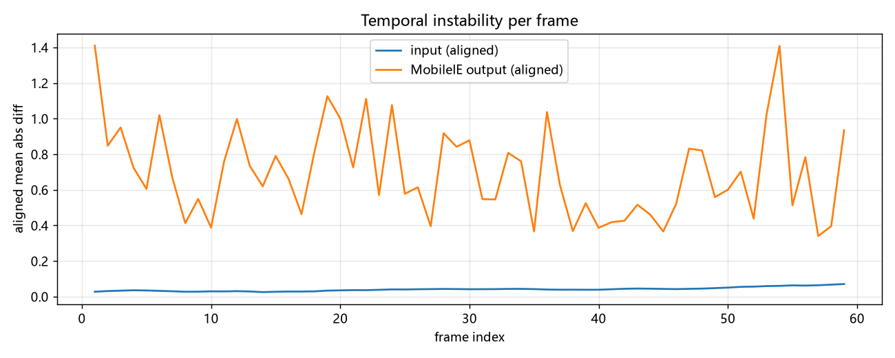

# 3. 视频闪烁（Video Flicker）基线实验

目标：量化「MobileIE 逐帧处理视频」产生的帧间不一致（闪烁），为后续时序一致性方法提供可复现的基线与度量。

- 状态：**基线已建立**（2026-11-01）
- 脚本：[`scripts/flicker_baseline.py`](scripts/flicker_baseline.py)、[`scripts/flicker_realistic.py`](scripts/flicker_realistic.py)、[`scripts/make_videos.py`](scripts/make_videos.py)、[`scripts/make_videos_realistic.py`](scripts/make_videos_realistic.py)、[`scripts/make_figures.py`](scripts/make_figures.py)
- 产物：`results/`（确定性基线）、`results_realistic/`（真实退化 + 消融）
- 汇报材料：[`report/meeting-brief.html`](report/meeting-brief.html)（资源内嵌，可离线打开）

## 1. 实验设计

MobileIE 面向单张图像训练，无时序建模。为隔离「增强不一致」这一因素，构造**已知运动**的合成视频：

| 项 | 设置 |
| --- | --- |
| 场景 | 静态大图（`assets/source_scene.jpg`，1600×1200）上做匀速平移裁剪（每帧 4 px），模拟相机平移 |
| 输入 | 对每一帧施加固定低光退化 `(x/255)^2.2 × 0.35`（模拟夜间拍摄） |
| 处理 | 用 `lolv1_best_slim.pkl` 权重逐帧独立推理（batch=1，无任何帧间信息） |
| 规模 | 60 帧，640×480，30 FPS |

**指标**（越小越稳定）：

1. `raw_diff`：相邻帧直接差值的平均绝对值；
2. `aligned_diff`：已知平移量，将当前帧反向平移后与前一帧比较——输入视频理论上应≈0，输出若>0 即为模型引入的不一致；
3. 放大倍数 = 输出 / 输入。

## 2. 结果

| 指标 | 输入（低光） | MobileIE 输出 | 放大 |
| --- | --- | --- | --- |
| raw_diff_mean | 0.789 | 6.780 | **8.59×** |
| aligned_diff_mean | 0.050 | 0.391 | **7.87×** |



- 输入视频对齐残差 ≈0.05（合成运动精确、退化确定），说明对齐度量可靠；
- 输出对齐残差 ≈0.39，且**随时间起伏**（纹理/亮度复杂处峰值更高），即肉眼所见的闪烁；
- 增强本身是全局缩放 + 非线性映射，却被放大近 8 倍的不一致，源自逐帧独立推理。

视频：`results/input_lowlight.mp4`、`output_mobileie.mp4`、`ground_truth.mp4`、`compare_side_by_side.mp4`（左：输入｜中：输出｜右：GT）。

## 3. 复现

```bash
# 推理（默认 cuda；本机在内存紧张时 CUDA 不稳定，可用 --device cpu）
PY=F:/dev-tools/python-envs/MobileIE-Neo/Scripts/python.exe
"$PY" research/3.video-flicker/scripts/flicker_baseline.py --device cpu
# 合成视频（独立进程，避免与 torch 争内存）
"$PY" research/3.video-flicker/scripts/make_videos.py
```

## 3.1 真实退化条件与机制消融（2026-11-03）

在合成视频上叠加手机夜景视频的典型退化（暗部泊松噪声 40 光子 + 读出噪声 + 逐帧 JPEG 70），并冻结 HDPA 全局注意力做消融：

| 条件 | 输入帧间残差 | 输出帧间残差 | 放大 | 输出亮度漂移（std） |
| --- | --- | --- | --- | --- |
| clean（仅低光） | 0.041 | **0.700** | **16.98×** | 1.67 |
| realistic（噪声 + 压缩） | 3.265 | **18.070** | 5.53× | 1.29 |
| realistic + 冻结全局注意力 | 3.263 | **18.189** | 5.57× | **0.56** |

结论：

1. 真实噪声下输出的帧间残差达到 **18.1/255（约 7.1%）**，肉眼可见颗粒抖动；
2. 网络对输入噪声**放大 5.5 倍**（clean 下输入几乎无扰动，放大达 17 倍）；
3. 冻结全局注意力**没有改善闪烁**（18.19 vs 18.07），仅把亮度漂移从 1.29 降到 0.56——**全局池化不是主因，局部高频噪声的逐帧随机性才是**。

## 3.2 闪烁来源拆解（2026-11-03）

分别开关各类退化（泊松噪声 / 逐帧 JPEG / 曝光抖动 ±3%），输出对齐帧间残差：

| 输入退化 | 输入残差 | 输出残差 | 放大 |
| --- | --- | --- | --- |
| none | 0.041 | 0.700 | 17.0× |
| noise | 6.30 | **16.78** | 2.7× |
| jpeg | 0.78 | **7.75** | 9.9× |
| exposure | 0.19 | 1.48 | 7.8× |
| noise+jpeg | 3.27 | 18.07 | 5.5× |
| noise+jpeg+exp | 3.25 | 18.08 | 5.6× |

结论：**暗部噪声是绝对主力**（16.8/18.1）；JPEG 压缩本身输入扰动很小，但被放大近 10 倍（0.78→7.75），不可忽视；曝光抖动贡献最小。图表：`results_ablation/ablation.png`。

> 注：各模式随机种子独立，输入残差不可直接横向比较，重点看"输出绝对量"与"放大倍数"。

## 3.3 Training-free 对照（2026-11-03）

对同一段真实退化视频做输出端平滑（α = 0.5 / 0.7 / 0.9），测闪烁与画质（vs GT）：

| 方法 | α | 闪烁 ↓ | PSNR ↑ | SSIM ↑ |
| --- | --- | --- | --- | --- |
| 无处理（MobileIE） | — | 18.07 | 14.88 | 0.337 |
| EMA（无运动补偿） | 0.9 | 5.82 | 15.39 | 0.538 |
| **光流对齐 EMA** | 0.9 | **4.83** | **15.47** | **0.575** |
| 输入（未增强） | — | 3.27 | 11.20 | 0.132 |

- 光流 EMA 把闪烁压到 4.83（−73%），且因去噪作用 PSNR/SSIM 反而更高；
- 但这是**慢速平移**场景的乐观结果：真实快速运动会出现拖影，且引入 1 帧延迟；
- 该结果作为"不做任何训练能压到哪"的参考线，同时说明**训练时引入时序约束的空间**（理想是既降闪烁又不牺牲动态）。
- 图表：`results_baselines/tradeoff.png`。

## 3.4 通用视频处理工具

[`scripts/process_video.py`](scripts/process_video.py)：任意视频 → 逐帧增强 → 光流对齐时序指标 + 对比视频。

```bash
python research/3.video-flicker/scripts/process_video.py -v path/to/video.mp4 -o out_dir \
  [--weights pretrain/lolv1_best_slim.pkl] [--max-frames 0]
```

真实素材到手后可直接运行（中间文件自动放在 ASCII 路径，规避中文路径问题）。

## 4. 局限

- 合成运动为纯平移，真实视频有运动模糊、曝光变化、压缩噪声；
- 仅 LLE 任务；ISP / UIE 未覆盖；
- 低光退化为固定 gamma，未覆盖真实传感器噪声；
- 仅比较「逐帧独立」基线，尚无平滑/时序方法对照。

## 5. 下一步

1. **真实视频验证**：用手机拍摄/公开数据集（如 REDS、手机夜景视频）替换合成视频，加入运动模糊与压缩噪声；
2. **建立对照基线**：
   - 输出端 EMA 平滑 / 光流 warp 对齐（training-free）；
   - 输入侧历史帧拼接（简单时序上下文）；
3. **指标扩展**：warping error（光流对齐）、闪烁频率分析；
4. 与导师讨论方向：训练阶段引入时序一致性约束 + 极轻量帧间模块（保持手机可跑）。
