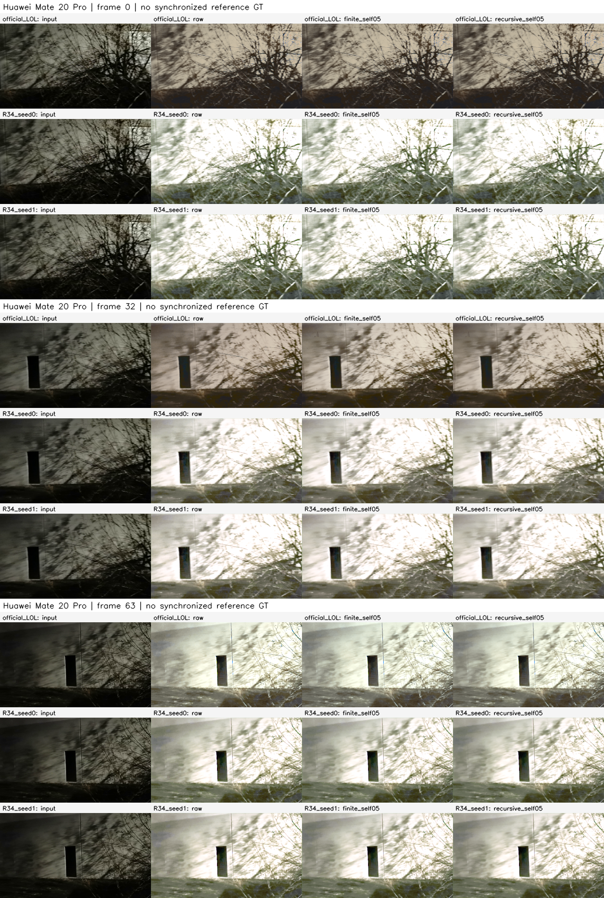
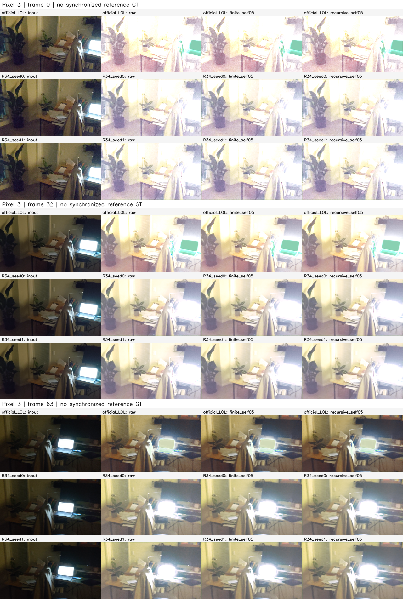
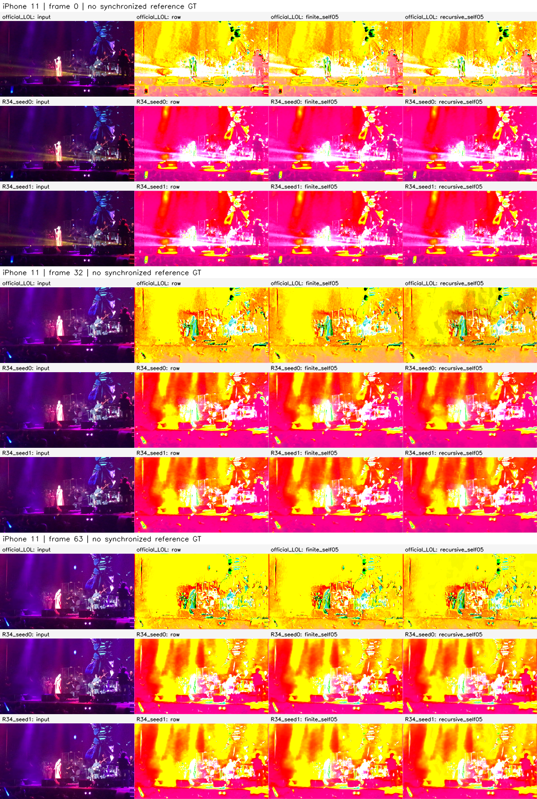

# Fixed references on real phone input

Three R31 DEV clips, original brightness and full field of view, no added degradation. Rows in each panel are official LOL / R34 seed0 / R34 seed1; columns repeat the input, raw, finite .5, recursive .5. Both seeds and every device are retained; no best-case selection.

No synchronized GT, PSNR/SSIM, true-flicker, user-study or phone-latency claim. Edge/brightness/endpoint statistics are diagnostics rather than a quality rank. MJPEG previews are all 64 frames at constant 30 fps for inspection, not sensor-time reproduction; original decoder timestamp records remain in R31. PNG contact sheets always show frames 0/32/63. Float32 arrays are the numerical source; PNG/AVI alone are not numerical evidence.

## Huawei Mate 20 Pro

[All 64 preview frames](../../../../.cache/experiments/exploration-r38/previews/Huawei_Mate_20_Pro_VID_20210209_183437.avi)

## Pixel 3

[All 64 preview frames](../../../../.cache/experiments/exploration-r38/previews/Pixel_3_VID_20210213_223036.avi)

## iPhone 11

[All 64 preview frames](../../../../.cache/experiments/exploration-r38/previews/iPhone_11_IMG_1541.avi)

