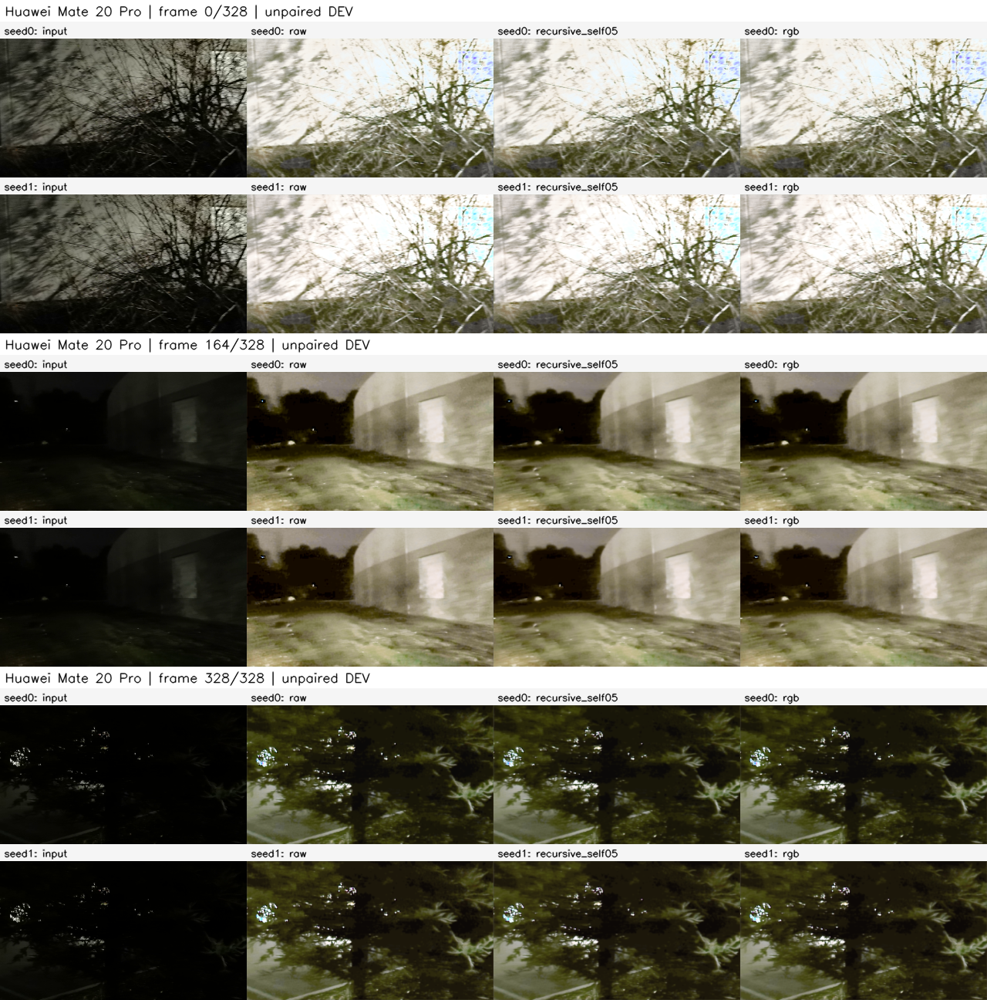
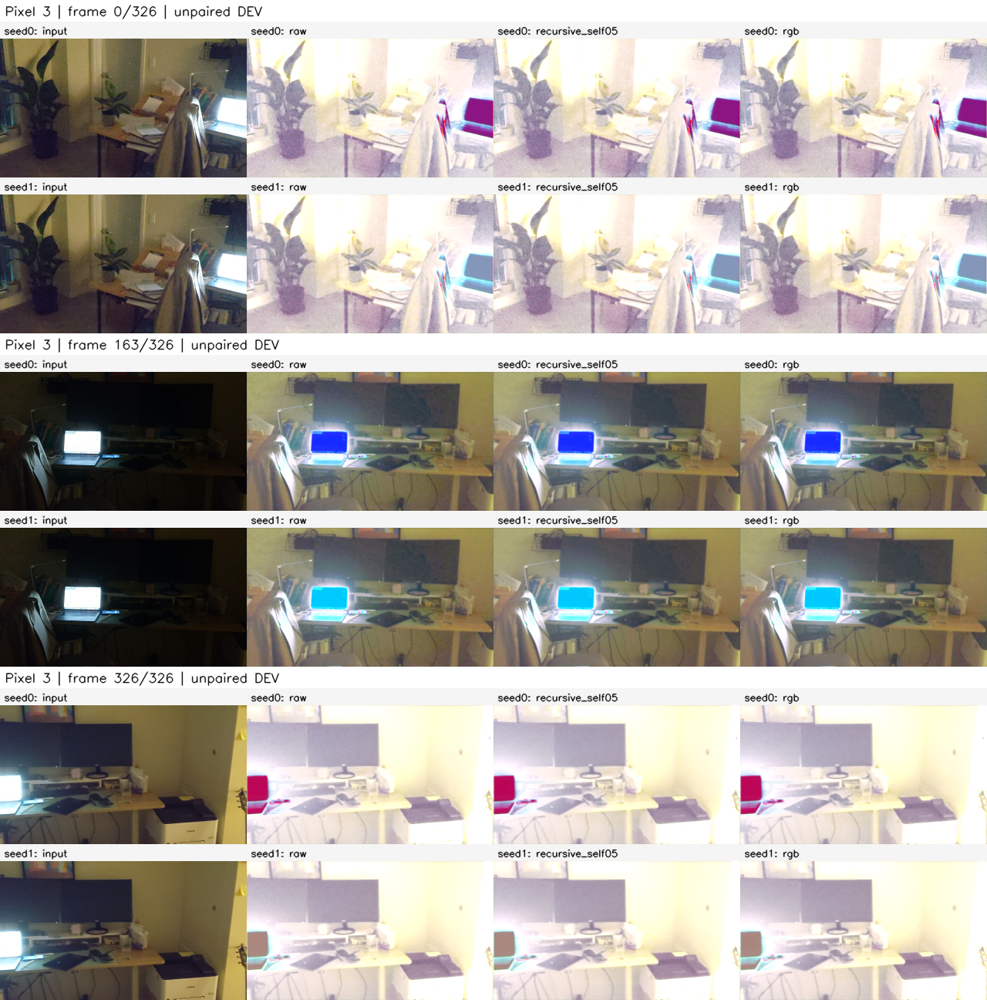
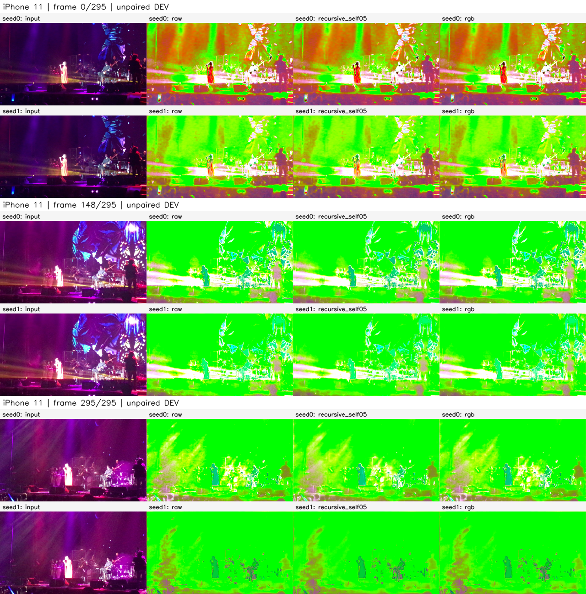
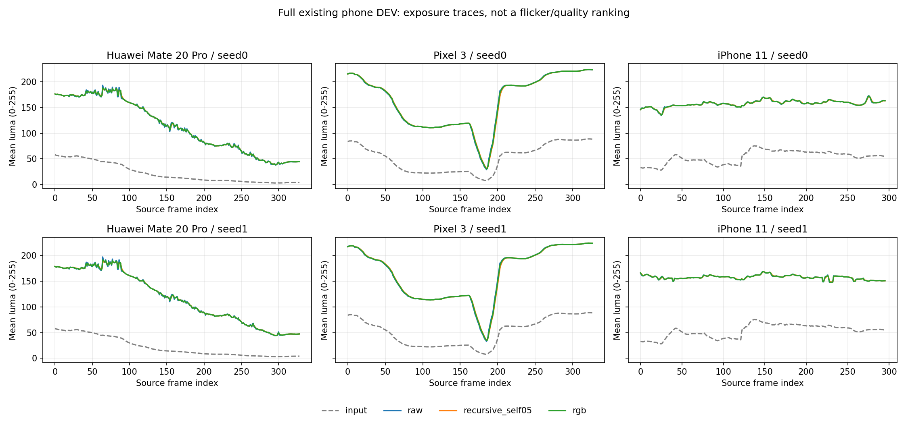
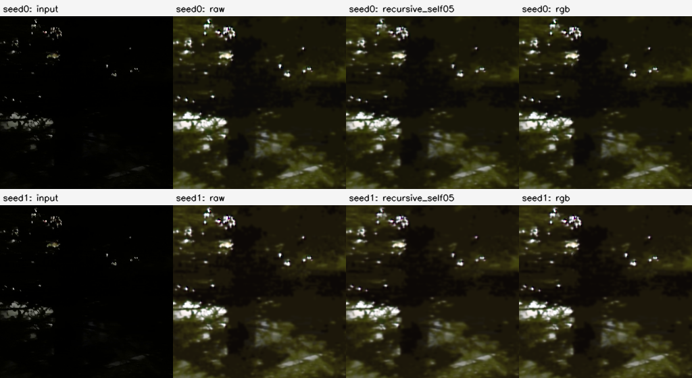
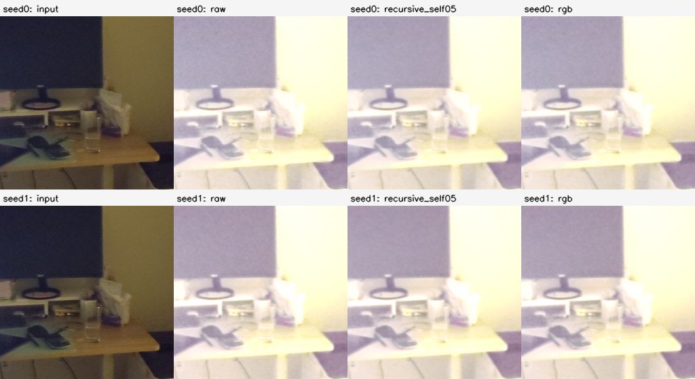
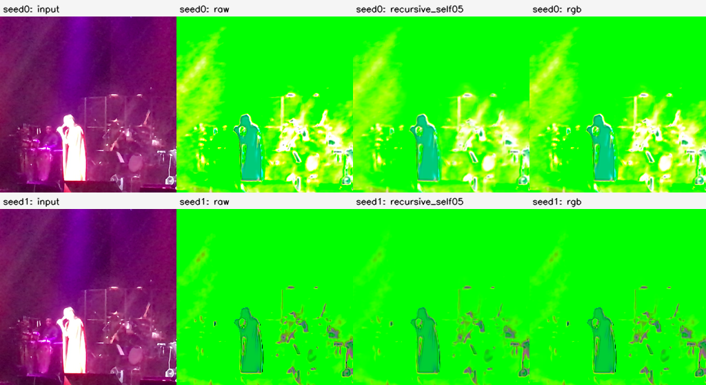

# Full existing phone DEV / frozen references

Huawei329 / Pixel327 / iPhone296, all EOF frames, same three existing DEV sources. Rows: seed0/seed1. Columns: input, R44 raw, recursive .5, R45 RGB. No selected best seed or frames.

No paired GT, PSNR/SSIM, user-study, true-flicker rank, new method or phone latency. Exposure/edge/warp statistics are diagnostic; smoother/darker output need not be better. Shared raw-flow is fixed within each seed, can differ across seeds, and has no GT-change compensation.

Contacts always show 0 / floor(T/2) / T-1. MJPEG contains all frames at constant30FPS for inspection; original R49 timestamps remain the source and are not reproduced by preview timing. FP32 arrays are the numerical source, PNG/AVI are visualizations.

## Huawei Mate 20 Pro

[All 329 preview frames](../../../../.cache/experiments/exploration-r54/previews/Huawei_Mate_20_Pro_VID_20210209_183437.avi)

## Pixel 3

[All 327 preview frames](../../../../.cache/experiments/exploration-r54/previews/Pixel_3_VID_20210213_223036.avi)

## iPhone 11

[All 296 preview frames](../../../../.cache/experiments/exploration-r54/previews/iPhone_11_IMG_1541.avi)

## Reviewed observations and native center regions

[Visual review and limitations](visual-review.md). All three main contacts, brightness panels, and the following fixed final-frame center regions were inspected. This does not imply human playback of every preview frame or GT quality.

