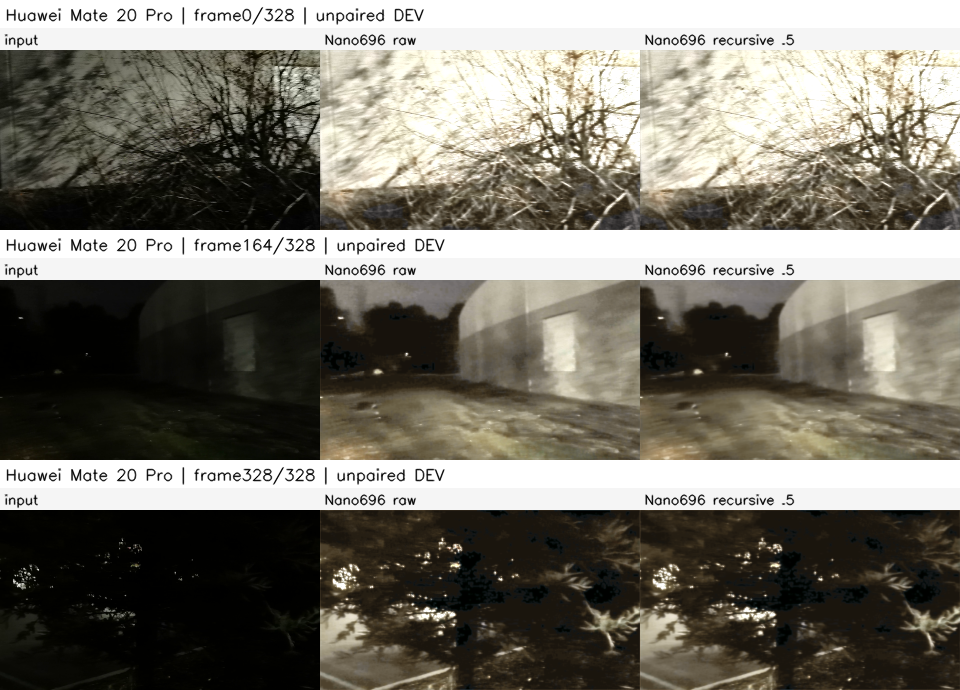
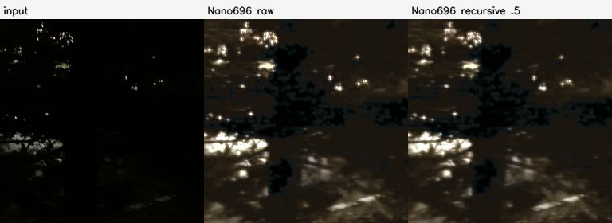
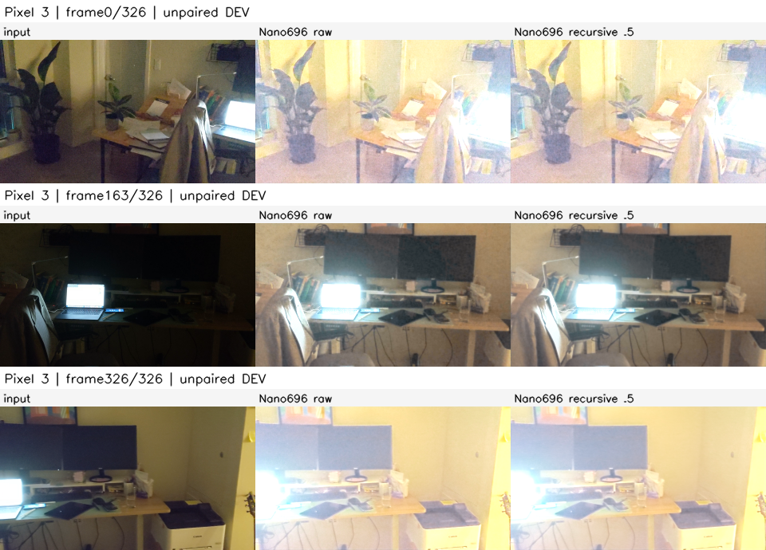
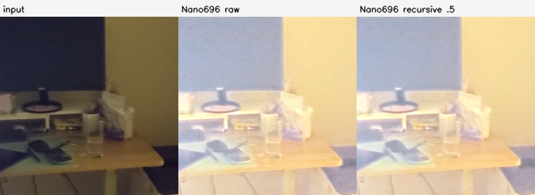
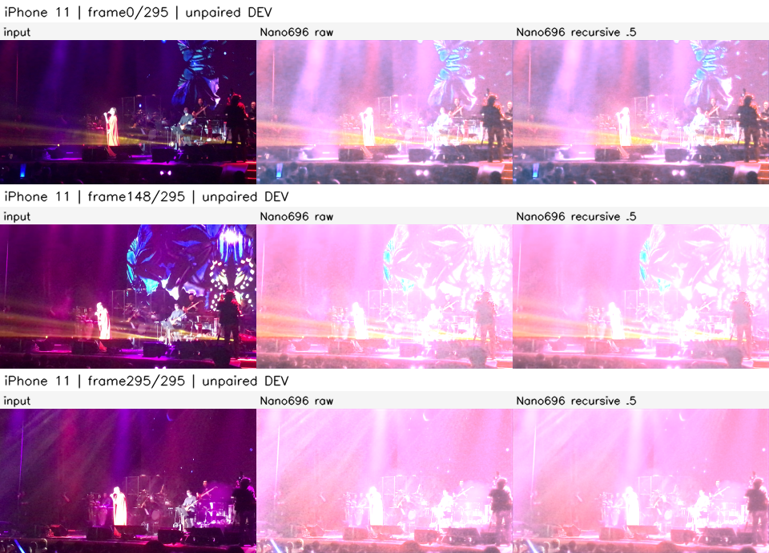
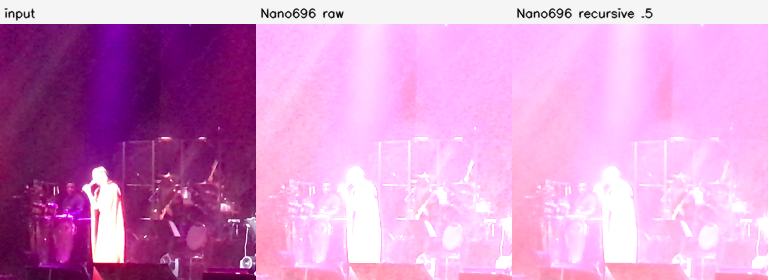
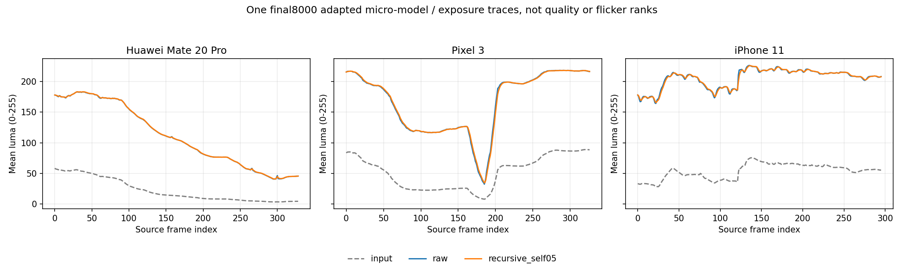

# Seed0: Fixed 696-parameter task-adapted reference / full phone DEV

One final8000 adapted seed, no intermediate-checkpoint or best-seed selection. Same three existing DEV sources, full EOF. Columns: input / Nano raw / own-raw half-FB recursive .5.

No paired GT, perceptual flicker truth or phone latency. Contacts are always 0/floor(T/2)/T-1; center regions always the final-frame central256x256. MJPEG shows all frames at constant30FPS for inspection, not original sensor-time playback. FP32 arrays and original R49 PTS remain the numeric/source evidence.

[Prior frozen MobileIE full-phone references](../../exploration-r54-full-phone/README.md). Different training histories; neither visual comparisons nor unpaired statistics establish an equal-budget or GT-quality ranking.

## Huawei Mate 20 Pro

[All329 preview frames](../../../../../.cache/experiments/exploration-r56/previews/seed0/Huawei_Mate_20_Pro_VID_20210209_183437.avi)

## Pixel 3

[All327 preview frames](../../../../../.cache/experiments/exploration-r56/previews/seed0/Pixel_3_VID_20210213_223036.avi)

## iPhone 11

[All296 preview frames](../../../../../.cache/experiments/exploration-r56/previews/seed0/iPhone_11_IMG_1541.avi)

