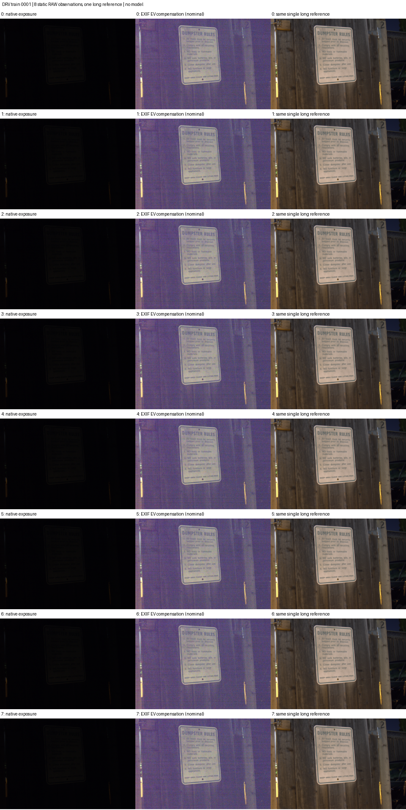
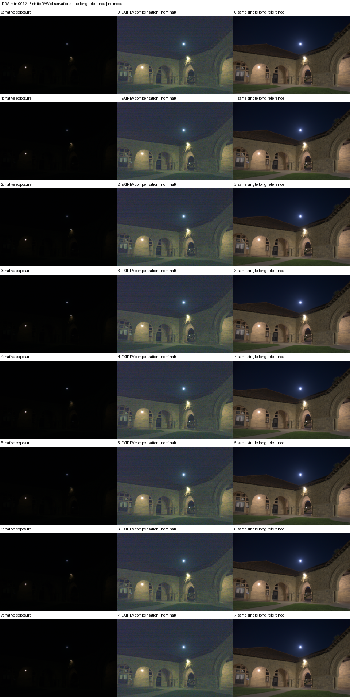
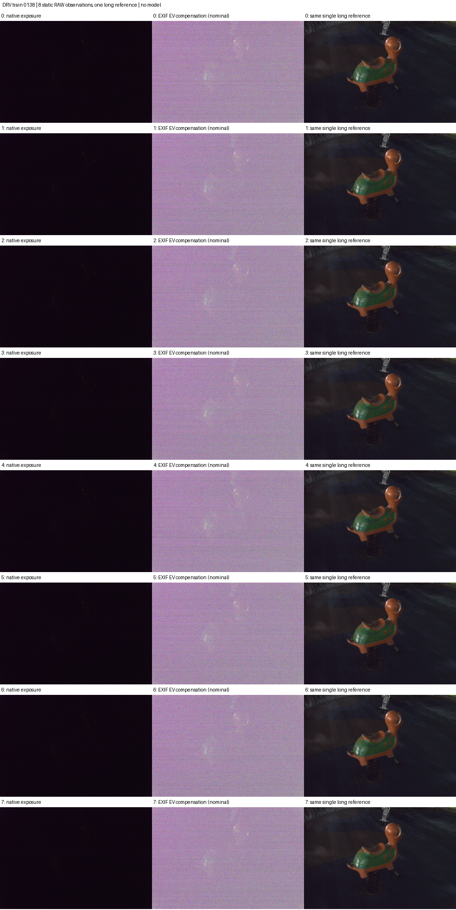
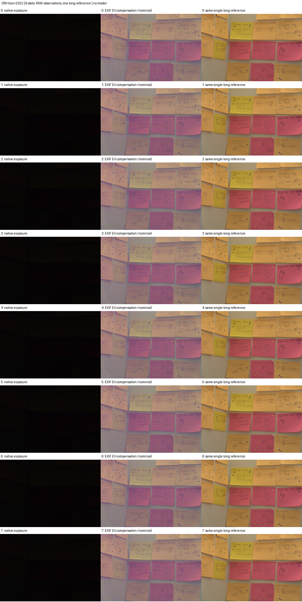

# R58 真实相机极低光静态资料：固定双视图

36原始RAW已完整取得；四官方train源×8连续短曝光，单一长曝光参考逐帧重复仅作配对便利。
不是完整标准/独立最终动态夜间测试，也不是手机成本或增强模型结果。0202拍摄于16:44，不能把全部四源称自然夜间。

**EV视图仅按EXIF比值作名义补偿，实测亮度并不匹配GT。** 内部键ev_matched保留原登记名称；不得据名字当成纯去噪基准。native保留原曝光。
图中“EXIF EV compensation (nominal)”纠正原标签，来自原缓存，未重做RAW处理、改gain/选帧或用GT拟合修正。

|源|ISO|EXIF倍率|native均值|名义EV均值|参考均值|EV/参考均值|
|---|---:|---:|---:|---:|---:|---:|
|0001|500|[150.0]|3.5803|104.4660|72.2839|1.4452|
|0072|200|[120.0]|1.8475|65.8789|49.1098|1.3415|
|0138|4000|[180.0]|12.0787|157.3535|33.5076|4.6960|
|0202|500|[150.0]|5.2214|128.8096|121.1051|1.0636|

均值为RGB通道0–255数值的全帧平均，只描述输入，不是质量/噪声参数/物理因果或时间一致性。
0138的名义EV视图严重偏亮偏紫；其余源也有颜色/噪声差异。保留所有源和视图，不校正到GT均值。
固定第一短帧WB，长短ISO/光圈/相机/几何与色矩阵资格均通过；这不证明逐像素精配准/辐照度一致或正确相机噪声标定。
rawpy0.25.1/LibRaw0.21.4半尺寸线性RGB16→固定缩放→sRGB→uint8，不含VBM4D，也不是作者原ISP复现。
各图8行依次为前8张短曝光；三列为native、名义EV补偿、同一长参考，不假定30FPS。

