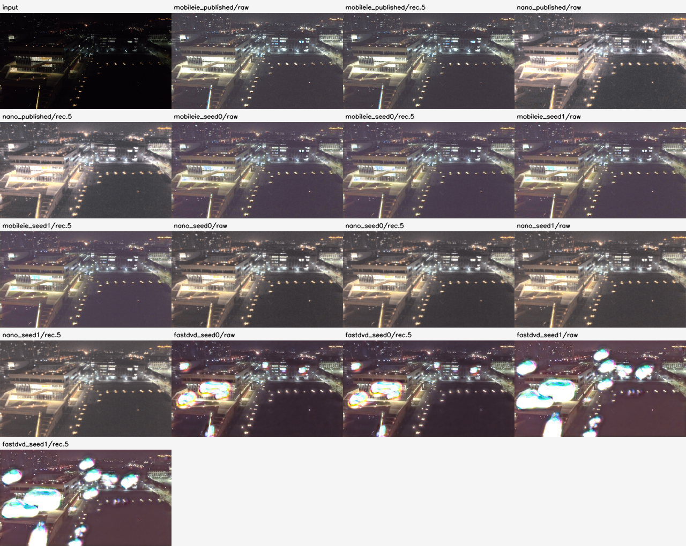
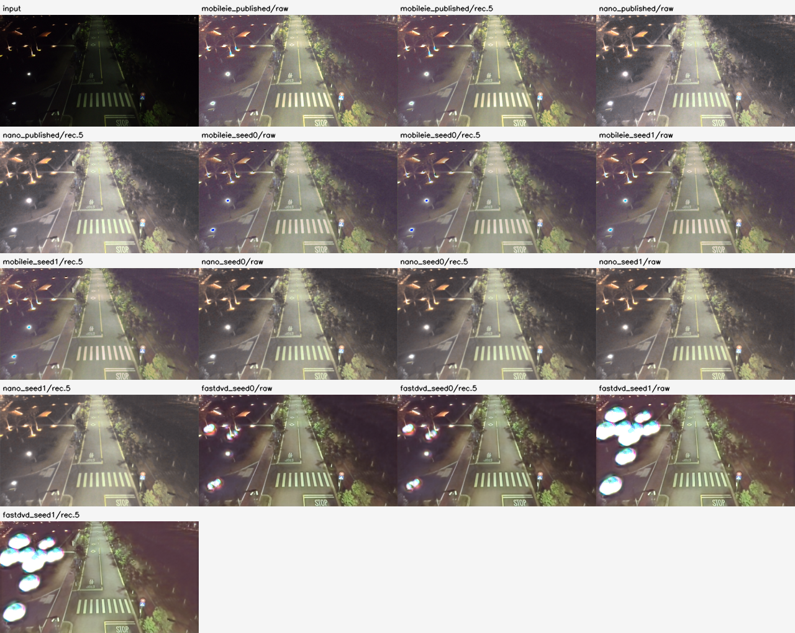
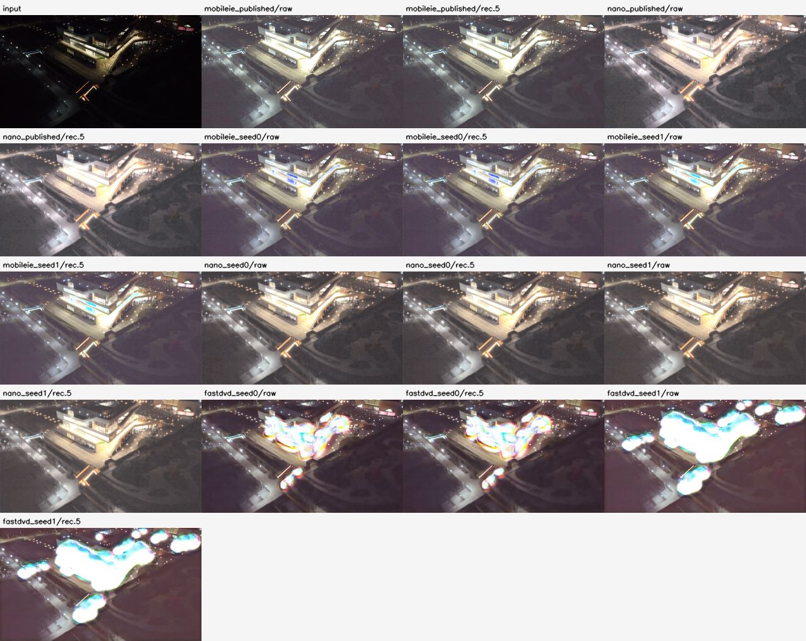
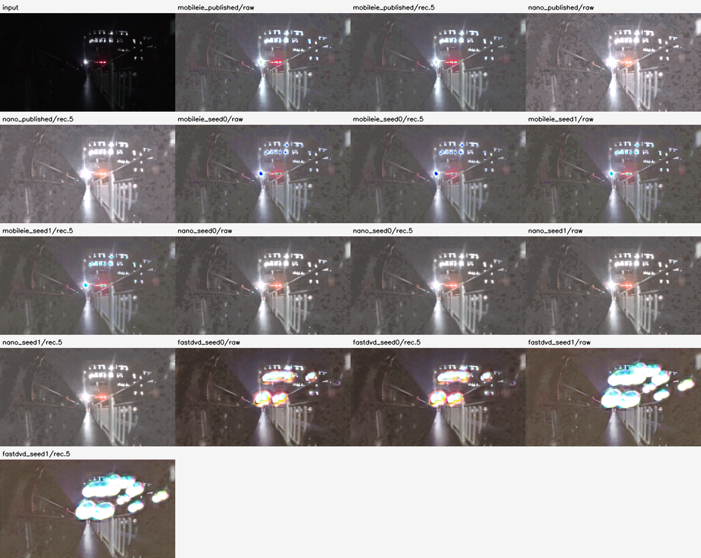
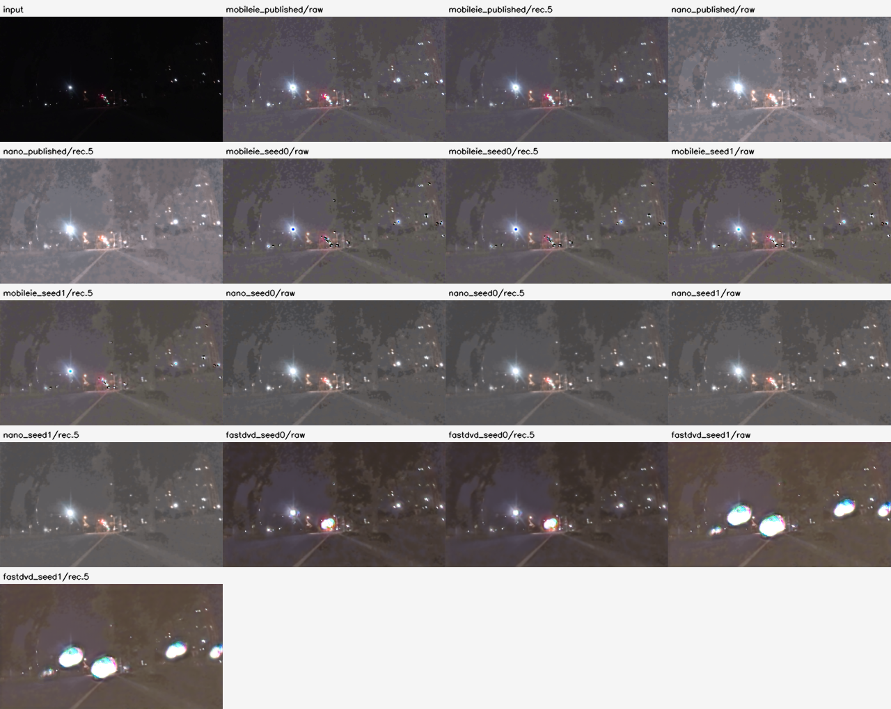
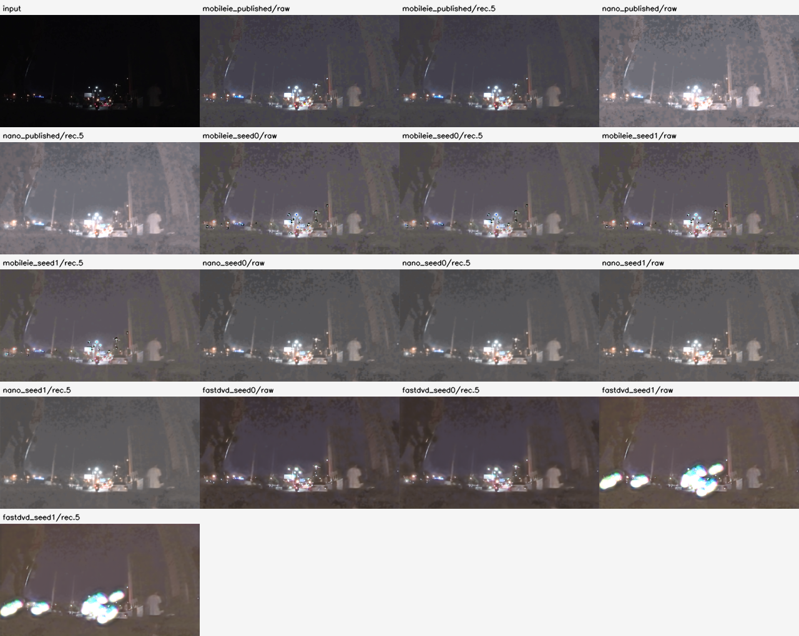

# R60 六段固定动态夜景：完整冻结参考

记录：2026-11-13T00:57:17.531322+08:00；作者：Codex  (sqs_A100)。

评价、汇总、12固定图和6预览均完整正常；全部8既有实例/各raw与classic recursive .5保留。768原输入观察、720共同主目标；48CNN/6144中心不是6144独立观察。无训练/GPU、配对GT、真实闪烁、手机或独立最终结论。

[完整16行描述表](tables.md) · [条件](conditions.json) · [实际输出检查](visual-review.md) · [解释与接续](../../docs/exploration-r60-night-reference-interpretation.md) · [作者来源](../../data/external-night-wenzhou/README.md) · [逐源结果](../../results/exploration-r60-wenzhou-reference-attempt001/per_sequence.jsonl)

每源固定中部128帧，主目标local4..123；不是全原视频或完整Night Wenzhou标准集。所有输出的描述流/接受域来自同一原输入，约98.99%接受率不保证运动正确，不能独立按代理排名。六预览回读各128，但没有人工完整视频播放；时间联系表实际查看也不等于用户评分。

以下中帧图包括输入+全部16输出。12时刻图固定4/15/26/36/47/58/69/80/91/101/112/123，未按模型结果换帧。预览和FP32数组仅本地自有data，Git保留图片/清单/过程；远端不分发大视频。

## DJI_0019

[固定12时刻，全部17信号](DJI_0019--fixed12.png) · [全部128帧预览，仅本地](../../../../.cache/experiments/exploration-r60/previews/attempt001/DJI_0019.avi)

## DJI_0021

[固定12时刻，全部17信号](DJI_0021--fixed12.png) · [全部128帧预览，仅本地](../../../../.cache/experiments/exploration-r60/previews/attempt001/DJI_0021.avi)

## DJI_0023

[固定12时刻，全部17信号](DJI_0023--fixed12.png) · [全部128帧预览，仅本地](../../../../.cache/experiments/exploration-r60/previews/attempt001/DJI_0023.avi)

## Gopro1

[固定12时刻，全部17信号](Gopro1--fixed12.png) · [全部128帧预览，仅本地](../../../../.cache/experiments/exploration-r60/previews/attempt001/Gopro1.avi)

## Gopro2

[固定12时刻，全部17信号](Gopro2--fixed12.png) · [全部128帧预览，仅本地](../../../../.cache/experiments/exploration-r60/previews/attempt001/Gopro2.avi)

## Gopro3

[固定12时刻，全部17信号](Gopro3--fixed12.png) · [全部128帧预览，仅本地](../../../../.cache/experiments/exploration-r60/previews/attempt001/Gopro3.avi)

