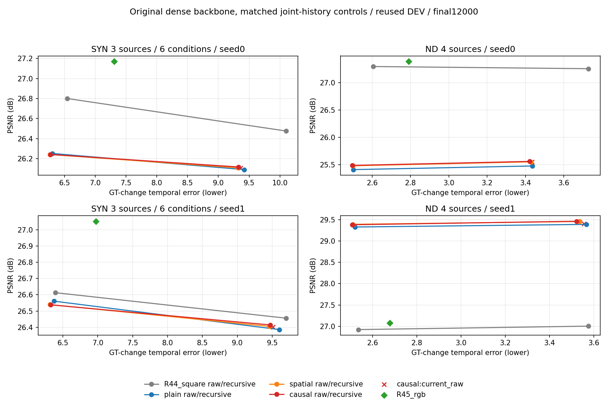

# R64 完整dense共同历史对照

创建：2026-11-13T02:24:20.359694+08:00；作者：Codex  (sqs_A100)。

全部24000更新、140质量行/80CNN/3584中心正常完成；history/A/B均False。不是新方法/手机或独立最终结论。

[完整全表](tables.md) · [止损决定](../../docs/exploration-r64-decision.md) · [实际视觉检查](visual-review.md) · [全部来源](visual_sources.json)

|固定条件|seed0|seed1|
|---|---|---|
|bear_photons20|[固定三帧](fixed-bear_photons20-seed0.png)|[固定三帧](fixed-bear_photons20-seed1.png)|
|bear_photons80|[固定三帧](fixed-bear_photons80-seed0.png)|[固定三帧](fixed-bear_photons80-seed1.png)|
|lucia_photons20|[固定三帧](fixed-lucia_photons20-seed0.png)|[固定三帧](fixed-lucia_photons20-seed1.png)|
|lucia_photons80|[固定三帧](fixed-lucia_photons80-seed0.png)|[固定三帧](fixed-lucia_photons80-seed1.png)|
|walking_photons20|[固定三帧](fixed-walking_photons20-seed0.png)|[固定三帧](fixed-walking_photons20-seed1.png)|
|walking_photons80|[固定三帧](fixed-walking_photons80-seed0.png)|[固定三帧](fixed-walking_photons80-seed1.png)|
|video_15|[固定三帧](fixed-video_15-seed0.png)|[固定三帧](fixed-video_15-seed1.png)|
|video_47|[固定三帧](fixed-video_47-seed0.png)|[固定三帧](fixed-video_47-seed1.png)|
|video_91|[固定三帧](fixed-video_91-seed0.png)|[固定三帧](fixed-video_91-seed1.png)|
|video_121|[固定三帧](fixed-video_121-seed0.png)|[固定三帧](fixed-video_121-seed1.png)|

所有紧凑图已实际查看，未人工完整播放视频。SYN0/32/63、ND0/8/15；所有模型/条件/seed保留，显示缩小会弱化细噪声。

[原分辨率20图归档](../../../../.cache/experiments/exploration-r64/full-contact-archive001/)仅在zrh自有data；[原full清单](../../process/exploration-r64/pack001/original_full_manifest.json)保留初次生成事实，当前可解析归档路径/原摘要及紧凑图摘要见visual_sources.json。

源码、结果、过程、报告分别小步提交，阶段推送；paper仍009证据稿，没有把该负结果改写成方法成功。
