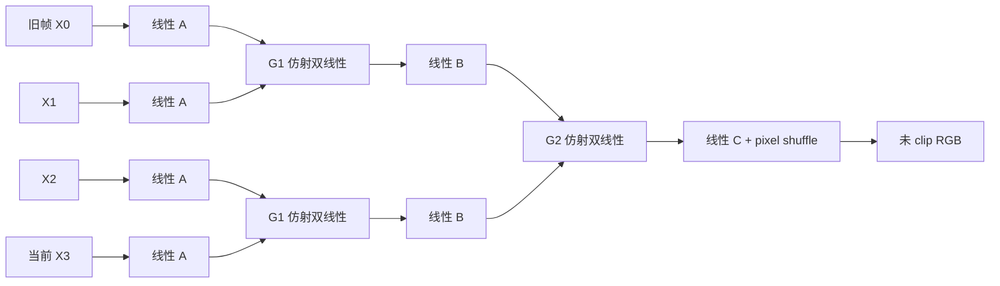

# M1：不重叠观测来源的多线性骨干

2026-11-20；Codex  (sqs_A100)。[直接先例](../../5.prior-art-survey/docs/76-polynomial-networks-and-observation-ancestry.md)、[原型](core.py)、[CPU资格](preflight-decision.md)、[固定空间恢复协议](spatial-protocol.md)。乘法/多项式/基础期望恒等式均已知，尚无确立创新、视频质量或手机结果。

当前完整空间必要检验已负结项：[0190](../../../docs/进展报告/0190-T-26112101-多线性骨干完整空间恢复与止损.md)、[完整决定](spatial-decision.md)、[真实终态](process/spatial-terminal001.json)。两架构各8K×两seed=32000正式更新/512000学生图、四唯一最终，固定保留训练抽样1536NN/384输出/128窗口/12均值全部完成。八项恢复保护0/8，M1对F0平均低1.45–3.65dB；对随机原SlimSYN/1平均+.247337dB但最差窗口仍失败。保留14/128对F0窗口PSNR正及其他取舍，详[全点/联系图与实际审阅](report/spatial-analysis/)。两学生与F0的预训/训练形态不同，不作纯架构排名。

原全部12具名句柄已无，六子任务事件exit0/协调runtime正常；外层工具session47202退出143原因未明，分开留证，不重启。40数值源/协议/CPU19与20冻结保持。固定width16/stride2/dilation2/初始化/GT目标/LR/长度/seed局部网格STOP，不延长/换loss补救，不进入视频/DEV/手机；新独立方向尚未登记。

原始raw四槽路径如下，共享A/B权重，第一层两帧对、第二层分支来源不重叠：

`G(u,v)=.5(u+v)+gamma*u*v+b`；当前空间diagonal把四槽都替换为同一当前帧，训练完全无历史。视频stream原型缓存上一编码和前两帧对中间值，前三帧当前输出，之后才读取四个不重叠观测。PReLU/HDPA/normalization已移除；观测相关性、输入均值变化、观测依赖field/状态量化/输出clip都会影响精确论证，原型未解决运动/遮挡。

实际5340参数，解析稳态卷积1308HW（1080p2.712269GMAC），B1 FP32缓存48HW字节（1080p99532800B）；比经典RGB状态更大，不是零开销或手机实测。未继承F0预训练/函数。GPU资格自身结束NVML944MiB、allocator峰326295552/reserved465567744B，设备匹配；仅资源证据，非推理性能。

入口：[正式训练](train_spatial.py)、[固定保留训练抽样](evaluate_spatial.py)、[完整汇总](summarize_spatial.py)、[资源协调](run_spatial.py)、[40具名源/输入冻结](process/spatial-source-freeze001.json)。40冻结/空间协议运行期间不可改，CPU原19/修正20源与首次元数据失败也完整保留。所有旧STOP、原84值/PDF020、独立最终、7号和其他worktree保持；原要求八项恢复保护全过才可另登记视频，本轮未通过。
