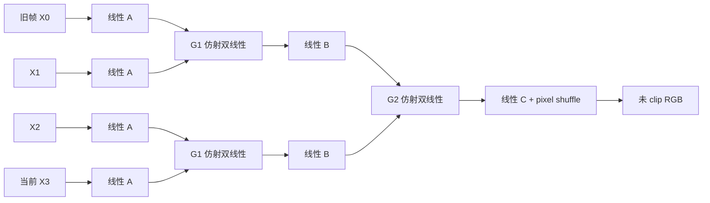

# M1：不重叠观测来源的多线性骨干

2026-11-20；Codex  (sqs_A100)。[直接先例](../../5.prior-art-survey/docs/76-polynomial-networks-and-observation-ancestry.md)、[原型](core.py)、[CPU资格](preflight-decision.md)、[固定空间恢复协议](spatial-protocol.md)。乘法/多项式/基础期望恒等式均已知，尚无确立创新、视频质量或手机结果。

当前空间首seed已完成两架构各8000/共16000更新及768NN/192窗口输出固定评价，原worker3394474/quality3414567均终态。原父3393743/start112972989已自动新准入启动第二seed原3415953/start113206445，GPU6/UUID尾f55fd249、继承计数0。[0189](../../../docs/进展报告/0189-T-26112100-多线性骨干首种子完整训练与第二种子接续.md)与[观察003](process/observations/checkpoint003.json)留00:30各1047/正式全局18094更新。恢复结果仍待完整双seed，不能按本段静态PID重启；后续核[实际链状态](process/spatial-chain001/state.json)。所有CPU/CUDA资格更新丢弃，不自动开启视频/DEV/最终。

原始raw四槽路径如下，共享A/B权重，第一层两帧对、第二层分支来源不重叠：

`G(u,v)=.5(u+v)+gamma*u*v+b`；当前空间diagonal把四槽都替换为同一当前帧，训练完全无历史。视频stream原型缓存上一编码和前两帧对中间值，前三帧当前输出，之后才读取四个不重叠观测。PReLU/HDPA/normalization已移除；观测相关性、输入均值变化、观测依赖field/状态量化/输出clip都会影响精确论证，原型未解决运动/遮挡。

实际5340参数，解析稳态卷积1308HW（1080p2.712269GMAC），B1 FP32缓存48HW字节（1080p99532800B）；比经典RGB状态更大，不是零开销或手机实测。未继承F0预训练/函数。GPU资格自身结束NVML944MiB、allocator峰326295552/reserved465567744B，设备匹配；仅资源证据，非推理性能。

入口：[正式训练](train_spatial.py)、[固定保留训练抽样](evaluate_spatial.py)、[完整汇总](summarize_spatial.py)、[资源协调](run_spatial.py)、[40具名源/输入冻结](process/spatial-source-freeze001.json)。40冻结/空间协议运行期间不可改，CPU原19/修正20源与首次元数据失败也完整保留。所有旧STOP、原84值/PDF020、独立最终、7号和其他worktree保持；只有八项恢复保护全部过，才另登记下一视频研究。
